# NexusOS — Unified Enterprise Operating System

<p align="center">
  <strong>One Platform. Every Department. Connected Workflows.</strong>
</p>

<p align="center">
  A centralized enterprise management platform designed to connect business departments, automate organizational workflows, and provide real-time operational insights.
</p>

<p align="center">
  
  
  
  
  
</p>

---

# PART I — SOFTWARE REQUIREMENTS SPECIFICATION (ENGLISH)

## 1. Project Overview

### 1.1 Project Information

| Field | Description |
|---|---|
| Project Name | NexusOS |
| Full Name | Unified Enterprise Operating System |
| Project Type | Enterprise Resource Planning (ERP) / Business Management System |
| Project Category | University Academic Project |
| Primary Goal | Centralized business management and workflow automation |
| Frontend | React, TypeScript, Tailwind CSS |
| Backend | Java, Spring Boot |
| Database | PostgreSQL |
| Authentication | Firebase Authentication |
| File Storage | Supabase Storage |
| Architecture | Modular Monolith |
| Primary Interface | Web Application |

### 1.2 Executive Summary

NexusOS is a proposed centralized enterprise management platform that connects different departments of an organization through a unified digital system.

In many organizations, departments such as Human Resources, Finance, Inventory, Procurement, Sales, and Project Management operate using separate applications, spreadsheets, and manual communication.

This creates disconnected information, duplicated work, delayed approvals, and difficulty monitoring organizational performance.

NexusOS aims to solve these problems by providing a centralized platform where departments can share authorized information, manage their activities, and automate business processes.

Its most important feature is the **Workflow Automation Engine**.

For example, when the IT department requests five laptops:

1. The department submits a purchase request.
2. The department manager reviews the request.
3. Finance checks the available budget.
4. Procurement selects a supplier.
5. An authorized person approves the purchase order.
6. Inventory records the received laptops.
7. IT assigns the laptops to employees.
8. Finance records the expense.
9. Management can view the updated business information.

The objective is to make business operations connected, transparent, traceable, and easier to manage.

### 1.3 Project Vision

To create one unified digital operating environment where every department can work together through connected data and automated business processes.

### 1.4 Tagline

**One Platform. Every Department. Connected Workflows.**

---

## 2. Problem Statement

Organizations often use separate systems or manual processes to manage their daily operations.

Common problems include:

- Employee information is stored in different spreadsheets.
- Attendance and payroll are managed separately.
- Purchase requests require manual communication.
- Inventory information is not updated immediately.
- Finance departments receive delayed expense information.
- Managers cannot easily monitor all departments.
- Approval processes take too much time.
- Business reports require manual preparation.
- Important organizational activities are difficult to track.
- Data duplication creates inconsistencies.

### 2.1 Proposed Solution

NexusOS provides:

- A centralized organizational database.
- Department-based management modules.
- Role-based access control.
- Automated approval workflows.
- Integrated finance and inventory operations.
- Centralized document management.
- Real-time notifications.
- Business analytics and reporting.
- Complete activity and audit history.

---

## 3. Project Objectives

### 3.1 Primary Objectives

1. Centralize organizational information.
2. Connect different departments through shared business processes.
3. Automate repetitive approval procedures.
4. Improve organizational communication.
5. Reduce manual data entry and duplication.
6. Provide accurate financial and operational reports.
7. Improve transparency and accountability.
8. Protect organizational information through access control.
9. Support multiple branches and departments.
10. Create an extensible platform for future business requirements.

### 3.2 Specific Objectives

| ID | Objective | Expected Result |
|---|---|---|
| OBJ-01 | Centralized management | One unified platform |
| OBJ-02 | Employee management | Organized HR records |
| OBJ-03 | Financial integration | Connected financial operations |
| OBJ-04 | Inventory tracking | Accurate stock information |
| OBJ-05 | Workflow automation | Faster approval processes |
| OBJ-06 | Business analytics | Better management decisions |
| OBJ-07 | Security | Controlled information access |
| OBJ-08 | Multi-branch support | Centralized organizational control |

---

## 4. Scope of the System

### 4.1 In Scope

The proposed system includes:

- Organization and branch management.
- Employee and HR management.
- Attendance and leave management.
- Payroll information management.
- Finance and accounting.
- Inventory and warehouse management.
- Procurement and supplier management.
- Customer relationship management.
- Sales management.
- Project management.
- Workflow automation.
- Internal communication.
- Document management.
- Notifications.
- Analytics and reporting.
- User roles and permissions.
- Audit logs.
- Multi-branch organizational support.

### 4.2 Out of Scope for Initial Version

The following features are not mandatory for the first prototype:

- Full banking integration.
- Automatic tax submission to government systems.
- Advanced biometric hardware integration.
- Native Android and iOS applications.
- Full enterprise-grade microservices infrastructure.
- Autonomous AI decision-making.
- Complex international accounting compliance.
- Automatic supplier payment processing.

These features may be considered in future versions.

---

## 5. Stakeholders and User Roles

### 5.1 Stakeholders

| Stakeholder | Responsibility |
|---|---|
| Super Administrator | Platform-level management |
| Company Administrator | Company configuration |
| HR Manager | Employee and HR operations |
| Finance Manager | Financial operations |
| Procurement Officer | Purchase management |
| Inventory Manager | Stock and warehouse management |
| Sales Manager | Sales operations |
| Project Manager | Project and task management |
| Department Manager | Department-level approvals |
| Employee | Personal information and requests |
| Executive | Business monitoring and reporting |

### 5.2 Role-Based Access Control (RBAC)

The system uses Role-Based Access Control.

A user receives permissions according to their assigned role and organizational scope.

| Role | Main Permissions |
|---|---|
| Super Admin | Platform administration |
| Company Admin | Company-wide configuration |
| HR Manager | HR and employee management |
| Finance Manager | Finance and accounting |
| Procurement Officer | Purchase requests and orders |
| Inventory Manager | Inventory operations |
| Sales Manager | Customer and sales management |
| Project Manager | Projects and tasks |
| Department Manager | Department approvals |
| Employee | Own profile, attendance, and requests |
| Executive | Authorized reports and dashboards |

**Important:** A role alone does not grant unrestricted access. The backend must also check the user's company, branch, department, resource ownership, and specific permissions.

---

## 6. System Modules

### 6.1 Organization Management

Features:

- Company profile.
- Branch creation.
- Department creation.
- Designation management.
- Organizational hierarchy.
- Organization chart.
- Branch transfers.
- Department assignments.
- Company configuration.

### 6.2 Human Resource Management

Features:

- Employee registration.
- Employee profiles.
- Employee identification numbers.
- Employee documents.
- Employment history.
- Department assignments.
- Designation management.
- Promotion records.
- Resignation records.
- Performance information.
- Employee status management.

### 6.3 Attendance Management

Features:

- Check-in and check-out.
- Working-hour calculation.
- Late-arrival detection.
- Early-departure detection.
- Shift schedules.
- Attendance corrections.
- Monthly attendance reports.
- Leave integration.

### 6.4 Leave Management

Features:

- Leave applications.
- Leave categories.
- Leave balance.
- Manager approval.
- Rejection with reasons.
- Leave history.
- Attendance synchronization.

### 6.5 Payroll Management

Features:

- Salary structure.
- Basic salary.
- Allowances.
- Bonuses.
- Deductions.
- Salary calculation.
- Payroll approval.
- Payslip generation.
- Payroll history.

Payroll calculations must follow configurable company policies and applicable regulations.

### 6.6 Finance and Accounting

Features:

- Income records.
- Expense records.
- Department budgets.
- Invoices.
- Accounts payable.
- Accounts receivable.
- Payment records.
- Cash-flow reports.
- Profit and loss reports.
- Double-entry accounting foundation.
- Financial transaction history.

### 6.7 Inventory Management

Features:

- Product registration.
- Product categories.
- SKU and barcode support.
- Warehouse management.
- Branch stock management.
- Stock-in operations.
- Stock-out operations.
- Stock transfers.
- Low-stock alerts.
- Asset tracking.
- Stock history.

### 6.8 Procurement Management

Features:

- Purchase requests.
- Supplier registration.
- Supplier quotations.
- Price comparison.
- Purchase approvals.
- Purchase orders.
- Goods receiving.
- Supplier invoices.
- Supplier payment tracking.

### 6.9 Customer Relationship Management (CRM)

Features:

- Customer profiles.
- Lead management.
- Follow-up records.
- Communication history.
- Customer feedback.
- Support tickets.
- Customer activity history.

### 6.10 Sales Management

Features:

- Product catalog.
- Customer quotations.
- Sales orders.
- Order approval.
- Delivery tracking.
- Sales invoices.
- Payment tracking.
- Product returns.
- Sales reports.

### 6.11 Project Management

Features:

- Project creation.
- Project budgets.
- Team assignment.
- Task creation.
- Task priorities.
- Deadlines.
- Kanban board.
- Gantt chart.
- Milestones.
- Time tracking.
- Project expense tracking.
- Progress reports.

### 6.12 Workflow Automation Engine

This is the core differentiating feature of NexusOS.

The Workflow Engine allows authorized users to configure business processes using triggers, conditions, actions, and approval steps.

**Main components:**

| Component | Description |
|---|---|
| Trigger | Starts a workflow |
| Condition | Checks whether a rule is satisfied |
| Action | Executes an operation |
| Approval | Requests authorization |
| Delay | Waits for a configured period |
| Notification | Sends an alert |
| Execution Log | Records workflow activity |
| Retry | Handles temporary failures |
| Versioning | Maintains workflow versions |

**Example workflow:**

```text
Purchase Request Created
          |
          v
Department Manager Approval
          |
          v
Budget Availability Check
          |
          v
Finance Approval
          |
          v
Procurement Processing
          |
          v
Purchase Order Created
          |
          v
Goods Received
          |
          v
Inventory Updated
          |
          v
Finance Expense Recorded
          |
          v
Workflow Completed
```

Additional automation examples:

- Leave approved → attendance updated.
- Product stock below threshold → notification generated.
- Sales order completed → inventory updated.
- Salary processed → financial transaction recorded.
- Project deadline approaching → manager notified.
- Employee resignation approved → account deactivation workflow initiated.

### 6.13 Communication Management

Features:

- Internal messages.
- Announcements.
- Department notices.
- Comments.
- Mentions.
- Email notifications.
- Push notifications.
- In-app notifications.

### 6.14 Document Management

Features:

- PDF upload.
- Image upload.
- Document categories.
- Access permissions.
- Document version history.
- Expiry reminders.
- Employee document storage.
- Purchase and invoice document storage.

### 6.15 Analytics and Business Intelligence

Features:

- Company dashboard.
- Revenue statistics.
- Expense statistics.
- Profit reports.
- Employee statistics.
- Attendance reports.
- Low-stock reports.
- Pending approval statistics.
- Branch comparison.
- Department comparison.
- Exportable reports.

### 6.16 Optional AI Business Assistant

A future AI assistant may answer questions using authorized business reports.

Example:

- Which department spent the most money this month?
- Which products have low stock?
- How many leave applications are pending?
- What is the total revenue this quarter?

The assistant must only access information that the requesting user is authorized to view.

It must not directly modify sensitive financial or HR records without an authorized workflow.

---

## 7. Software Requirements Specification (SRS)

### 7.1 Functional Requirements

Functional requirements describe what the system must do.

#### Organization Management

| Requirement ID | Requirement | Priority |
|---|---|---|
| FR-ORG-001 | The system shall allow authorized users to create company profiles. | High |
| FR-ORG-002 | The system shall support multiple branches. | High |
| FR-ORG-003 | The system shall support department creation. | High |
| FR-ORG-004 | The system shall manage employee designations. | High |
| FR-ORG-005 | The system shall maintain organizational hierarchy. | Medium |

#### Authentication and Authorization

| Requirement ID | Requirement | Priority |
|---|---|---|
| FR-AUTH-001 | The system shall authenticate users. | High |
| FR-AUTH-002 | The system shall verify Firebase ID tokens on the backend. | High |
| FR-AUTH-003 | The system shall assign roles to users. | High |
| FR-AUTH-004 | The system shall enforce permission checks on protected APIs. | High |
| FR-AUTH-005 | The system shall support account deactivation. | High |
| FR-AUTH-006 | The system shall restrict access by company and organizational scope. | High |

#### Human Resource Management

| Requirement ID | Requirement | Priority |
|---|---|---|
| FR-HR-001 | The system shall create employee profiles. | High |
| FR-HR-002 | The system shall update employee information. | High |
| FR-HR-003 | The system shall maintain employment history. | Medium |
| FR-HR-004 | The system shall manage employee documents. | Medium |
| FR-HR-005 | The system shall record promotion and resignation information. | Medium |

#### Attendance and Leave

| Requirement ID | Requirement | Priority |
|---|---|---|
| FR-ATT-001 | The system shall record employee check-in and check-out. | High |
| FR-ATT-002 | The system shall calculate working hours. | High |
| FR-ATT-003 | The system shall identify late arrivals. | Medium |
| FR-ATT-004 | The system shall generate attendance reports. | High |
| FR-LEAVE-001 | Employees shall be able to submit leave applications. | High |
| FR-LEAVE-002 | Authorized managers shall approve or reject leave applications. | High |
| FR-LEAVE-003 | The system shall maintain leave balances. | High |
| FR-LEAVE-004 | Approved leave shall update relevant attendance records. | High |

#### Finance

| Requirement ID | Requirement | Priority |
|---|---|---|
| FR-FIN-001 | The system shall record income and expenses. | High |
| FR-FIN-002 | The system shall maintain department budgets. | High |
| FR-FIN-003 | The system shall generate financial reports. | High |
| FR-FIN-004 | The system shall manage invoices. | Medium |
| FR-FIN-005 | The system shall maintain payment records. | High |
| FR-FIN-006 | The system shall support double-entry accounting records. | Medium |

#### Inventory and Procurement

| Requirement ID | Requirement | Priority |
|---|---|---|
| FR-INV-001 | The system shall register products. | High |
| FR-INV-002 | The system shall track stock quantities. | High |
| FR-INV-003 | The system shall support warehouse and branch stock. | High |
| FR-INV-004 | The system shall record stock transfers. | High |
| FR-INV-005 | The system shall generate low-stock alerts. | Medium |
| FR-PROC-001 | The system shall allow users to submit purchase requests. | High |
| FR-PROC-002 | The system shall support supplier management. | High |
| FR-PROC-003 | The system shall manage purchase orders. | High |
| FR-PROC-004 | The system shall record received goods. | High |

#### CRM and Sales

| Requirement ID | Requirement | Priority |
|---|---|---|
| FR-CRM-001 | The system shall maintain customer profiles. | Medium |
| FR-CRM-002 | The system shall manage leads and follow-ups. | Medium |
| FR-SALES-001 | The system shall create sales orders. | High |
| FR-SALES-002 | The system shall generate sales invoices. | High |
| FR-SALES-003 | The system shall track customer payments. | High |
| FR-SALES-004 | The system shall update inventory after confirmed sales fulfillment. | High |

#### Project Management

| Requirement ID | Requirement | Priority |
|---|---|---|
| FR-PM-001 | Authorized users shall create projects. | Medium |
| FR-PM-002 | Project managers shall assign tasks. | Medium |
| FR-PM-003 | Users shall update task progress. | Medium |
| FR-PM-004 | The system shall display project deadlines. | Medium |
| FR-PM-005 | The system shall generate project progress reports. | Medium |

#### Workflow Automation

| Requirement ID | Requirement | Priority |
|---|---|---|
| FR-WF-001 | Authorized users shall create workflows. | High |
| FR-WF-002 | The system shall support configurable triggers. | High |
| FR-WF-003 | The system shall evaluate workflow conditions. | High |
| FR-WF-004 | The system shall execute configured actions. | High |
| FR-WF-005 | The system shall support approval steps. | High |
| FR-WF-006 | The system shall record workflow execution history. | High |
| FR-WF-007 | The system shall support retry handling for recoverable failures. | Medium |
| FR-WF-008 | The system shall maintain workflow versions. | Medium |
| FR-WF-009 | The system shall prevent unauthorized workflow modifications. | High |

#### Communication, Documents, and Reports

| Requirement ID | Requirement | Priority |
|---|---|---|
| FR-COM-001 | The system shall send in-app notifications. | Medium |
| FR-COM-002 | The system shall support organizational announcements. | Medium |
| FR-DOC-001 | Authorized users shall upload documents. | Medium |
| FR-DOC-002 | The system shall enforce document access permissions. | High |
| FR-REP-001 | The system shall generate business reports. | High |
| FR-REP-002 | The system shall support date-based report filtering. | Medium |
| FR-REP-003 | The system shall restrict reports according to user permissions. | High |
| FR-AUD-001 | The system shall record important administrative activities. | High |

### 7.2 Non-Functional Requirements

| ID | Category | Requirement |
|---|---|---|
| NFR-001 | Security | Sensitive operations must require server-side authorization. |
| NFR-002 | Performance | Common operations should respond within an agreed performance target under expected load. |
| NFR-003 | Scalability | The architecture should support increasing users and business records. |
| NFR-004 | Reliability | Failed operations must not leave inconsistent business records. |
| NFR-005 | Usability | The interface must be understandable and consistent. |
| NFR-006 | Maintainability | The codebase must use modular architecture and clear naming. |
| NFR-007 | Availability | Deployment should provide documented availability expectations. |
| NFR-008 | Compatibility | The web application should support modern browsers. |
| NFR-009 | Accessibility | Important user flows should support keyboard navigation and readable contrast. |
| NFR-010 | Data Integrity | Financial and inventory operations must preserve data consistency. |
| NFR-011 | Auditability | Important changes must be traceable. |
| NFR-012 | Privacy | Users must only access authorized personal and organizational information. |
| NFR-013 | Backup | Database backup and recovery procedures must be documented. |
| NFR-014 | Localization | The interface should be designed to support future multilingual functionality. |

Performance targets should be measured under a documented test environment rather than assumed to be guaranteed.

---

## 8. Use Cases

### 8.1 Main Use Cases

| Use Case ID | Use Case | Primary Actor |
|---|---|---|
| UC-01 | Login | All Users |
| UC-02 | Manage Organization | Company Admin |
| UC-03 | Manage Employees | HR Manager |
| UC-04 | Submit Leave Request | Employee |
| UC-05 | Approve Leave Request | Department Manager |
| UC-06 | Manage Payroll | HR / Finance |
| UC-07 | Create Purchase Request | Employee / Department Manager |
| UC-08 | Approve Purchase Request | Manager / Finance |
| UC-09 | Manage Inventory | Inventory Manager |
| UC-10 | Create Sales Order | Sales Manager |
| UC-11 | Manage Projects | Project Manager |
| UC-12 | Configure Workflow | Company Admin |
| UC-13 | View Reports | Authorized Management |
| UC-14 | Review Audit Logs | Authorized Administrator |

### 8.2 Use Case Diagram

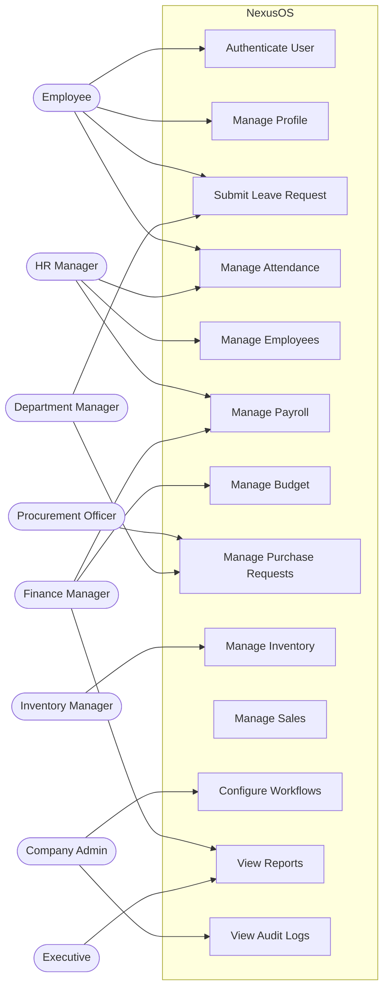

---

## 9. Business Workflow Design

### 9.1 Integrated Purchase Workflow

The purchase workflow demonstrates how NexusOS connects multiple departments.

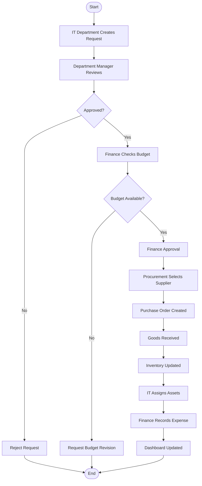

### 9.2 Leave Approval Workflow

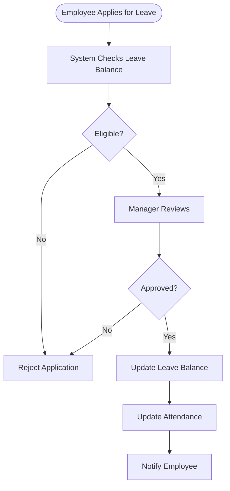

### 9.3 Workflow Engine Execution Model

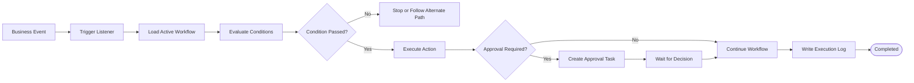

---

## 10. System Architecture

### 10.1 Architectural Approach

NexusOS will initially use a **Modular Monolith Architecture**.

A modular monolith keeps the application in one deployable backend while organizing business functionality into independent modules.

This approach is suitable for a university project because it:

- Reduces deployment complexity.
- Makes debugging easier.
- Supports clear module boundaries.
- Allows transactions across related business operations.
- Can later be separated into services if required.

### 10.2 High-Level Architecture Diagram

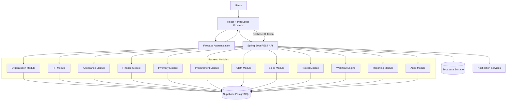

### 10.3 Request Lifecycle

1. User opens the React application.
2. Firebase Authentication authenticates the user.
3. Frontend receives an identity token.
4. Frontend sends the token with an API request.
5. Spring Security verifies the token.
6. Backend identifies the user and checks organizational scope.
7. The relevant business module processes the request.
8. PostgreSQL stores or retrieves authorized business data.
9. The backend returns the response.
10. The frontend updates the interface.

### 10.4 Component Diagram

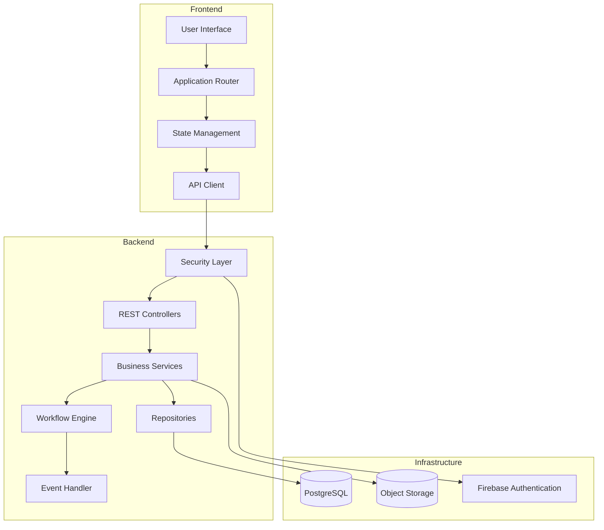

---

## 11. Sequence Diagrams

### 11.1 User Login and API Authentication

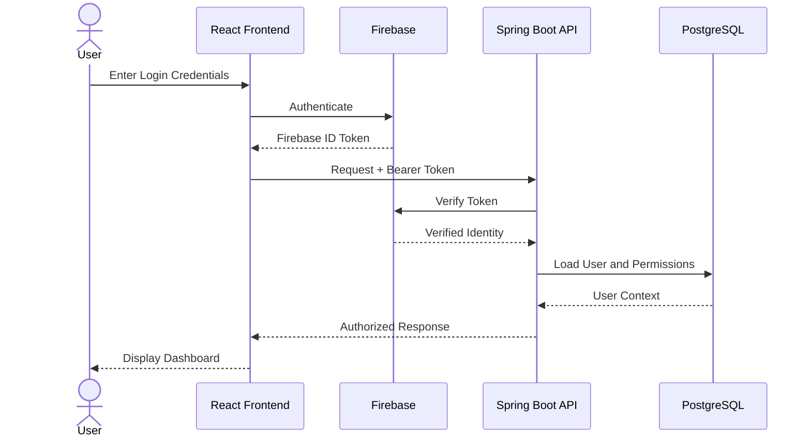

### 11.2 Leave Approval

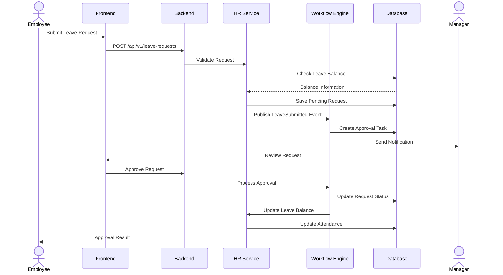

### 11.3 Purchase Request

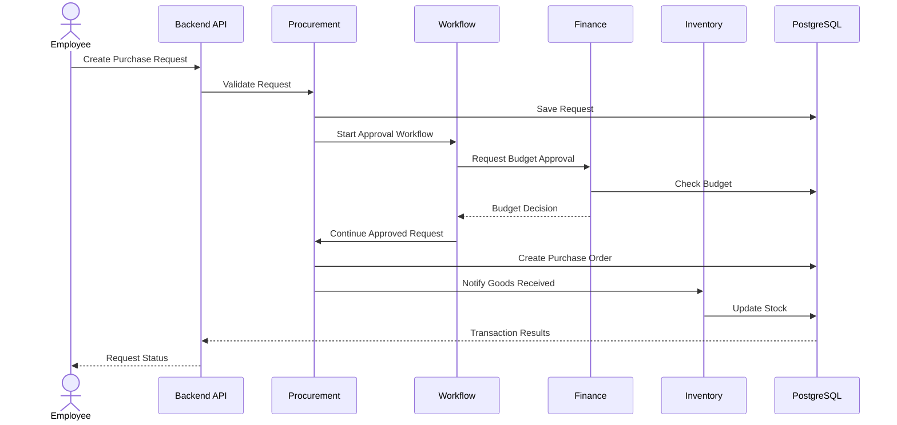

---

## 12. Class Diagram

The following diagram shows a simplified object-oriented domain model.

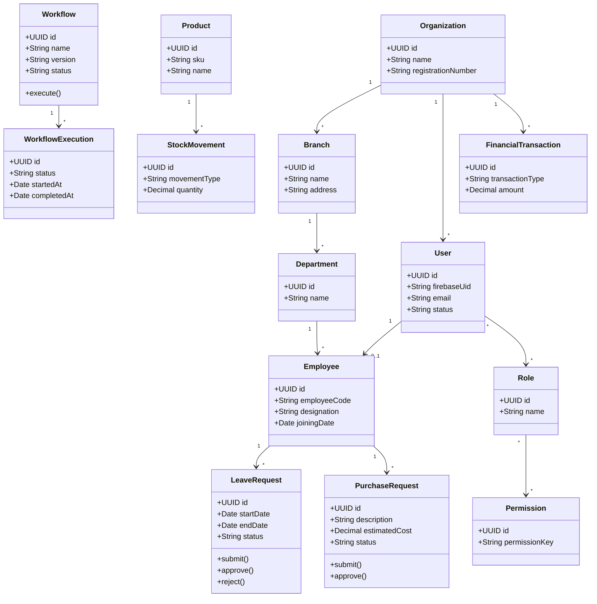

---

## 13. Workflow State Diagram

A workflow instance moves through controlled states.

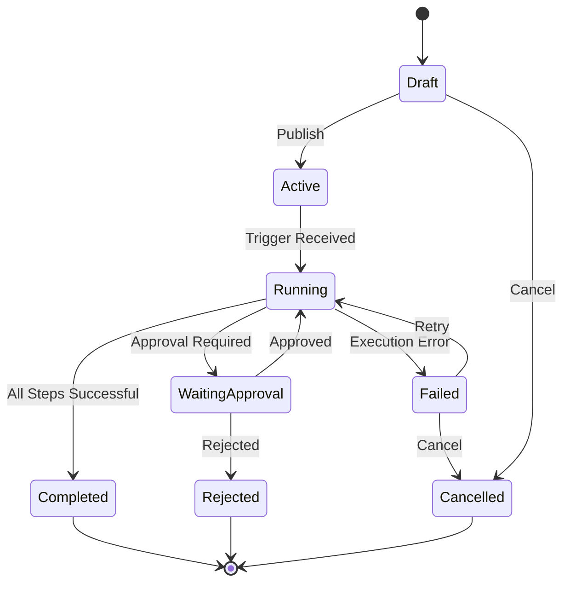

### 13.1 Business Request Statuses

Common request statuses:

- Draft
- Submitted
- Pending Approval
- Approved
- Rejected
- Processing
- Completed
- Cancelled

Every status transition must be validated by the backend.

---

## 14. Entity Relationship Diagram (ERD)

The following ERD represents a simplified database design. The production database may include additional tables, indexes, constraints, and junction entities.

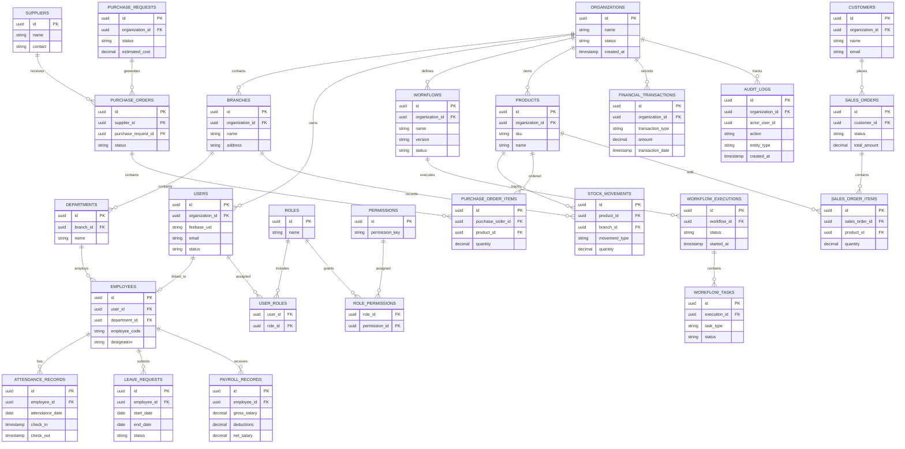

### 14.1 Database Design Principles

- Use UUID primary keys.
- Use foreign keys to maintain relationships.
- Use appropriate indexes for frequently queried fields.
- Store timestamps consistently in UTC.
- Use database transactions for related operations.
- Use decimal types for monetary values.
- Avoid deleting financial records that must be retained for audit purposes.
- Use soft deletion only where appropriate.
- Keep organization identifiers on tenant-owned records.
- Validate organizational ownership on every protected operation.

### 14.2 Multi-Tenant Data Isolation

Every tenant-owned record must be associated with an organization.

For example:

```text
Organization A
    |
    +-- Branch A1
    +-- Branch A2

Organization B
    |
    +-- Branch B1
    +-- Branch B2
```

Users from Organization A must never access Organization B's private data.

This restriction must be enforced by backend authorization and database design, not merely by hiding frontend pages.

---

## 15. API Design

### 15.1 API Conventions

Base path:

```text
/api/v1
```

Use:

- RESTful endpoint naming.
- JSON request and response bodies.
- HTTP status codes.
- Bearer token authentication.
- Pagination for large collections.
- Validation errors with meaningful messages.
- Consistent error response structures.

### 15.2 Example API Endpoints

| Method | Endpoint | Purpose |
|---|---|---|
| GET | `/api/v1/users/me` | Current user profile |
| GET | `/api/v1/organizations` | List authorized organizations |
| POST | `/api/v1/organizations` | Create organization |
| GET | `/api/v1/employees` | List employees |
| POST | `/api/v1/employees` | Create employee |
| GET | `/api/v1/attendance` | View attendance |
| POST | `/api/v1/attendance/check-in` | Check in |
| POST | `/api/v1/attendance/check-out` | Check out |
| GET | `/api/v1/leave-requests` | List leave requests |
| POST | `/api/v1/leave-requests` | Submit leave request |
| POST | `/api/v1/leave-requests/{id}/approve` | Approve leave |
| POST | `/api/v1/leave-requests/{id}/reject` | Reject leave |
| GET | `/api/v1/products` | List products |
| POST | `/api/v1/products` | Create product |
| POST | `/api/v1/purchase-requests` | Create purchase request |
| GET | `/api/v1/purchase-orders` | List purchase orders |
| POST | `/api/v1/sales-orders` | Create sales order |
| GET | `/api/v1/workflows` | List workflows |
| POST | `/api/v1/workflows` | Create workflow |
| POST | `/api/v1/workflows/{id}/publish` | Publish workflow |
| GET | `/api/v1/reports/overview` | Business overview |
| GET | `/api/v1/audit-logs` | View authorized audit logs |

### 15.3 Example Request

```http
POST /api/v1/leave-requests
Authorization: Bearer FIREBASE_ID_TOKEN
Content-Type: application/json
```

```json
{
  "startDate": "2026-12-10",
  "endDate": "2026-12-12",
  "leaveType": "ANNUAL",
  "reason": "Personal reasons"
}
```

### 15.4 Example Response

```json
{
  "success": true,
  "message": "Leave request submitted successfully.",
  "data": {
    "id": "REQUEST_UUID",
    "status": "PENDING_APPROVAL"
  }
}
```

### 15.5 Standard Error Response

```json
{
  "success": false,
  "message": "You do not have permission to perform this action.",
  "code": "FORBIDDEN",
  "timestamp": "2026-11-08T10:00:00Z"
}
```

---

## 16. Technology Stack

| Layer | Technology | Purpose |
|---|---|---|
| Frontend | React | User interface |
| Language | TypeScript | Type-safe frontend development |
| Styling | Tailwind CSS | Responsive styling |
| Workflow UI | React Flow | Visual workflow editor |
| Charts | Recharts | Data visualization |
| Backend | Java 21+ | Backend programming |
| Framework | Spring Boot | Application framework |
| Security | Spring Security | API security |
| ORM | Spring Data JPA / Hibernate | Database access |
| API | REST | Frontend-backend communication |
| Database | PostgreSQL | Business data storage |
| Database Hosting | Supabase | Managed PostgreSQL |
| Authentication | Firebase Authentication | User identity |
| Storage | Supabase Storage | Document and image storage |
| Notifications | Firebase Cloud Messaging (optional) | Push notifications |
| Testing | JUnit 5 | Backend testing |
| Mocking | Mockito | Unit test isolation |
| E2E Testing | Playwright | Browser testing |
| Version Control | Git | Source control |
| Repository | GitHub | Collaboration |

### 16.1 Why This Stack?

**React + TypeScript**

Provides a component-based frontend with better type safety.

**Spring Boot**

Provides a structured Java backend with security, database integration, and REST API support.

**PostgreSQL**

Provides relational data management and transactional consistency.

**Firebase Authentication**

Handles user identity and authentication.

**Supabase Storage**

Stores documents and images without placing large files directly in the database.

**React Flow**

Helps build the visual workflow editor.

### 16.2 Important Architecture Decision

Firebase Authentication is used for identity, not as the primary business database.

PostgreSQL remains the primary source of truth for organizational and financial records.

The backend must verify Firebase ID tokens and independently enforce permissions.

---

## 17. Object-Oriented Programming Concepts

NexusOS uses Object-Oriented Programming (OOP) principles.

### 17.1 Encapsulation

Encapsulation keeps data and related operations together.

Example:

```java
public class Employee {

    private String employeeCode;
    private String designation;

    public String getEmployeeCode() {
        return employeeCode;
    }

    public void updateDesignation(String designation) {
        if (designation == null || designation.isBlank()) {
            throw new IllegalArgumentException(
                "Designation cannot be empty"
            );
        }

        this.designation = designation;
    }
}
```

### 17.2 Inheritance

Inheritance allows related classes to reuse common properties.

```java
public abstract class BaseEntity {

    protected UUID id;
    protected Instant createdAt;
    protected Instant updatedAt;
}
```

### 17.3 Abstraction

Abstraction exposes essential operations without exposing internal implementation details.

```java
public interface NotificationService {

    void sendNotification(
        String recipient,
        String message
    );
}
```

### 17.4 Polymorphism

Polymorphism allows different implementations of a common interface.

```java
public class EmailNotificationService
        implements NotificationService {

    @Override
    public void sendNotification(
            String recipient,
            String message) {
        // Email implementation
    }
}
```

```java
public class PushNotificationService
        implements NotificationService {

    @Override
    public void sendNotification(
            String recipient,
            String message) {
        // Push notification implementation
    }
}
```

### 17.5 SOLID Principles

| Principle | Application |
|---|---|
| S — Single Responsibility | Each service handles one business responsibility |
| O — Open/Closed | New workflow actions can be added without rewriting the engine |
| L — Liskov Substitution | Implementations remain compatible with their interfaces |
| I — Interface Segregation | Small, focused service interfaces |
| D — Dependency Inversion | Services depend on abstractions |

---

## 18. Design Patterns

| Design Pattern | Proposed Application |
|---|---|
| Factory | Creating workflow action handlers |
| Strategy | Different approval and calculation policies |
| Observer | Reacting to business events |
| State | Managing request and workflow states |
| Command | Representing executable workflow actions |
| Chain of Responsibility | Processing approval stages |
| Builder | Constructing complex report and workflow objects |

### 18.1 Example: Strategy Pattern

```java
public interface ApprovalStrategy {

    boolean approve(PurchaseRequest request);
}
```

```java
public class ManagerApprovalStrategy
        implements ApprovalStrategy {

    @Override
    public boolean approve(PurchaseRequest request) {
        return request.getEstimatedCost() <= 10000;
    }
}
```

The example is illustrative. Real approval decisions must use configurable business rules and authorization checks rather than relying on a hard-coded amount.

### 18.2 Example: Observer Pattern

A purchase request event can notify multiple independent listeners:

```text
Purchase Request Created
          |
          +----> Notification Listener
          |
          +----> Workflow Listener
          |
          +----> Audit Listener
```

---

## 19. Security Requirements

Security is a critical requirement because the system handles employee, financial, customer, and organizational information.

### 19.1 Authentication

- Firebase Authentication.
- Firebase ID token verification on the backend.
- Secure session handling.
- Account deactivation.
- Token expiration handling.

### 19.2 Authorization

- Role-Based Access Control.
- Permission-based API authorization.
- Organization-level isolation.
- Branch-level restrictions.
- Department-level restrictions.
- Resource ownership checks.

### 19.3 Data Protection

- HTTPS in deployment.
- Environment variables for secrets.
- No credentials in GitHub.
- Secure file access.
- Input validation.
- SQL injection protection through parameterized database operations.
- Appropriate output encoding.
- Rate limiting for sensitive endpoints.
- Audit logging.

### 19.4 Audit Logging

Important events should record:

- User ID.
- Organization ID.
- Action performed.
- Entity type.
- Entity ID.
- Previous value where appropriate.
- New value where appropriate.
- Timestamp.
- Request or correlation ID.

Audit logs should be protected against unauthorized modification.

### 19.5 Security Rule

**Frontend permissions are not security boundaries. Every sensitive action must be authorized by the backend.**

---

## 20. Testing Strategy

### 20.1 Unit Testing

Tools:

- JUnit 5.
- Mockito.

Test individual services, validation rules, calculations, and workflow components.

### 20.2 Integration Testing

Test:

- Database operations.
- Authentication verification.
- API authorization.
- Service-to-service interactions.
- Workflow execution.
- Transaction consistency.

### 20.3 End-to-End Testing

Tool: Playwright.

Test important user journeys:

1. User login.
2. Employee creation.
3. Leave application.
4. Leave approval.
5. Purchase request.
6. Budget approval.
7. Goods receiving.
8. Inventory update.
9. Report generation.

### 20.4 Example Acceptance Criteria

| Feature | Acceptance Criteria |
|---|---|
| Login | Valid users can authenticate |
| Authorization | Unauthorized users cannot access protected resources |
| Employee Management | Authorized HR users can manage employee records |
| Leave | Employees can submit leave applications |
| Approval | Only authorized approvers can approve requests |
| Inventory | Stock movements are recorded correctly |
| Procurement | Approved purchases can generate purchase orders |
| Workflow | Workflow executions are traceable |
| Reporting | Reports respect organizational permissions |
| Audit | Important changes produce audit records |

### 20.5 Testing Flow

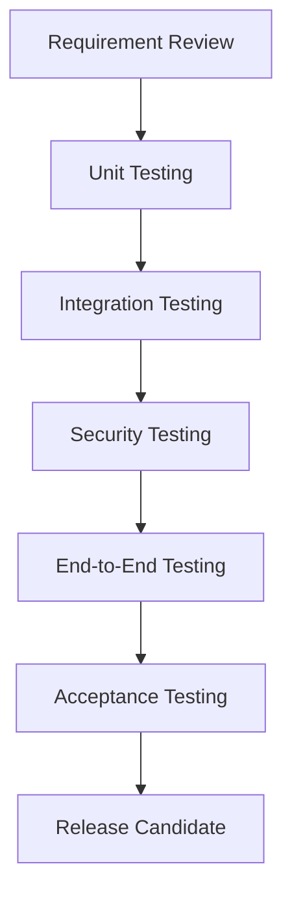

---

## 21. Deployment Architecture

### 21.1 Proposed Deployment

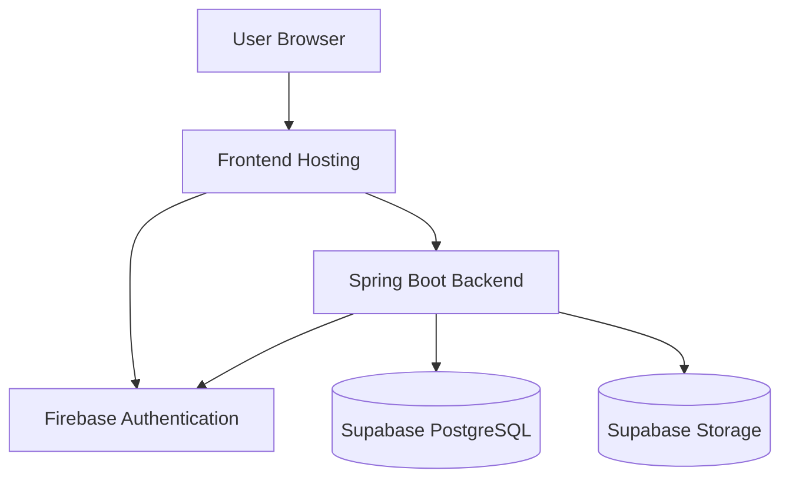

### 21.2 Development Environment

Recommended local setup:

- Windows, Linux, or macOS.
- Node.js LTS.
- Java 21 or newer supported version.
- Maven.
- Git.
- PostgreSQL or Supabase project.
- Firebase project.
- IDE such as IntelliJ IDEA or Visual Studio Code.

### 21.3 Environment Variables

Example frontend `.env.example`:

```env
VITE_API_BASE_URL=http://localhost:8080/api/v1

VITE_FIREBASE_API_KEY=YOUR_FIREBASE_API_KEY
VITE_FIREBASE_AUTH_DOMAIN=YOUR_FIREBASE_AUTH_DOMAIN
VITE_FIREBASE_PROJECT_ID=YOUR_FIREBASE_PROJECT_ID
```

Example backend configuration:

```env
SERVER_PORT=8080

DATABASE_URL=YOUR_DATABASE_URL
DATABASE_USERNAME=YOUR_DATABASE_USERNAME
DATABASE_PASSWORD=YOUR_DATABASE_PASSWORD

FIREBASE_PROJECT_ID=YOUR_FIREBASE_PROJECT_ID

SUPABASE_URL=YOUR_SUPABASE_URL
SUPABASE_SERVICE_ROLE_KEY=YOUR_SERVER_SIDE_SECRET
```

**Security warning:** Never commit real secrets, service-role keys, private keys, or passwords to GitHub. Use deployment-provider secret management.

The Firebase web configuration is not a substitute for backend security. Backend credentials must remain server-side.

### 21.4 Deployment Considerations

Possible student-prototype hosting options:

- Frontend: Vercel or Cloudflare Pages.
- Backend: Render or another Java-compatible hosting provider.
- Database: Supabase PostgreSQL.
- Authentication: Firebase Authentication.
- Storage: Supabase Storage.

Free-tier availability, limits, and sleep behavior can change. Production hosting may require paid services.

---

## 22. Project Structure

### 22.1 Frontend Structure

```text
nexusos-frontend/
│
├── public/
│
├── src/
│   ├── assets/
│   │
│   ├── components/
│   │   ├── common/
│   │   ├── layout/
│   │   ├── forms/
│   │   └── charts/
│   │
│   ├── modules/
│   │   ├── organization/
│   │   ├── employees/
│   │   ├── attendance/
│   │   ├── leave/
│   │   ├── payroll/
│   │   ├── finance/
│   │   ├── inventory/
│   │   ├── procurement/
│   │   ├── crm/
│   │   ├── sales/
│   │   ├── projects/
│   │   ├── workflows/
│   │   ├── documents/
│   │   └── reports/
│   │
│   ├── hooks/
│   ├── services/
│   ├── contexts/
│   ├── routes/
│   ├── types/
│   ├── utils/
│   ├── config/
│   │
│   ├── App.tsx
│   └── main.tsx
│
├── .env.example
├── package.json
└── README.md
```

### 22.2 Backend Structure

```text
nexusos-backend/
│
├── src/
│   ├── main/
│   │   ├── java/com/nexusos/
│   │   │
│   │   │   ├── config/
│   │   │   ├── security/
│   │   │   ├── common/
│   │   │   ├── exception/
│   │   │   │
│   │   │   ├── organization/
│   │   │   ├── user/
│   │   │   ├── employee/
│   │   │   ├── attendance/
│   │   │   ├── leave/
│   │   │   ├── payroll/
│   │   │   ├── finance/
│   │   │   ├── inventory/
│   │   │   ├── procurement/
│   │   │   ├── crm/
│   │   │   ├── sales/
│   │   │   ├── project/
│   │   │   ├── workflow/
│   │   │   ├── notification/
│   │   │   ├── document/
│   │   │   ├── reporting/
│   │   │   └── audit/
│   │   │
│   │   └── resources/
│   │       ├── application.yml
│   │       └── db/migration/
│   │
│   └── test/
│
├── pom.xml
├── .env.example
└── README.md
```

### 22.3 Module Structure Convention

Each backend module should separate responsibilities:

```text
employee/
├── controller/
├── service/
├── repository/
├── entity/
├── dto/
├── mapper/
└── validation/
```

---

## 23. Development Roadmap

The following is a proposed implementation sequence, not a statement of completed work.

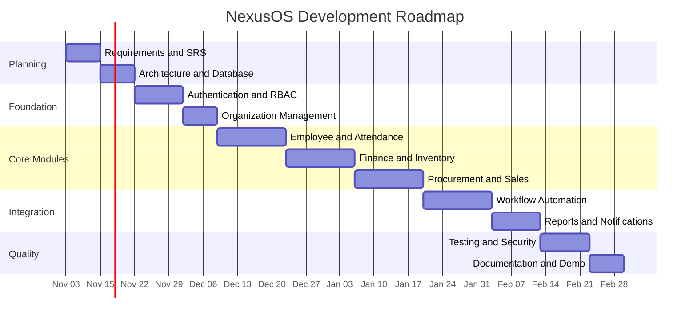

### 23.1 Proposed Development Phases

| Phase | Work | Expected Deliverable |
|---|---|---|
| Phase 1 | Requirements and planning | SRS and architecture |
| Phase 2 | Database and authentication | Secure foundation |
| Phase 3 | Organization and HR | Employee management |
| Phase 4 | Attendance and leave | HR operational workflow |
| Phase 5 | Finance and inventory | Integrated business records |
| Phase 6 | Procurement and sales | Purchase-to-sales operations |
| Phase 7 | Workflow engine | Automated approval system |
| Phase 8 | Analytics and notifications | Management dashboard |
| Phase 9 | Testing and deployment | Demonstrable prototype |

The schedule should be adjusted according to team capacity and academic deadlines.

---

## 24. Three-Member Team Responsibilities

The following allocation is a suggested starting point.

| Member | Primary Responsibility | Tasks |
|---|---|---|
| Member 1 | Backend and Workflow | Spring Boot APIs, business logic, workflow engine, authorization |
| Member 2 | Frontend and UI/UX | React application, dashboards, forms, workflow editor |
| Member 3 | Database, Integration and QA | PostgreSQL design, Firebase integration, testing, documentation |

### 24.1 Shared Responsibilities

All team members should participate in:

- Requirement analysis.
- Architecture discussions.
- Code reviews.
- Integration testing.
- Bug fixing.
- Demonstration preparation.
- Documentation updates.

### 24.2 Suggested Presentation Division

| Presenter | Presentation Topics |
|---|---|
| Presenter 1 | Introduction, problem, objectives, system modules |
| Presenter 2 | Workflow engine, architecture, technology stack, database |
| Presenter 3 | OOP, design patterns, integrated example, roadmap and conclusion |

---

## 25. Risks, Assumptions and Constraints

### 25.1 Risks

| Risk | Impact | Mitigation |
|---|---|---|
| Complex workflow logic | High | Build the engine incrementally |
| Database inconsistency | High | Use transactions and constraints |
| Unauthorized data access | Critical | Server-side authorization and tenant isolation |
| Scope expansion | High | Define an MVP |
| Team integration issues | Medium | Use clear API contracts |
| Hosting limitations | Medium | Maintain a local demo environment |
| Incomplete testing | High | Automate critical user journeys |

### 25.2 Assumptions

- Users have internet access.
- The organization provides accurate business information.
- Administrators configure roles and permissions.
- Each company has a unique organization identifier.
- The backend is the authority for business rules.
- External services may have free-tier limitations.

### 25.3 Constraints

- Limited university project development time.
- Limited team size.
- Limited hosting budget.
- External service availability.
- Limited access to real enterprise data.

---

## 26. Future Enhancements

Possible future features include:

1. AI-powered business analytics.
2. Predictive inventory management.
3. Advanced workflow recommendations.
4. Mobile applications.
5. Biometric attendance integration.
6. Advanced financial forecasting.
7. Supplier performance analytics.
8. Advanced project resource planning.
9. Multi-language support.
10. Integration with external accounting systems.
11. Microservices migration if justified by scale.
12. Advanced business intelligence dashboards.

---

## 27. Glossary

| Term | Meaning |
|---|---|
| ERP | Enterprise Resource Planning |
| CRM | Customer Relationship Management |
| HRM | Human Resource Management |
| RBAC | Role-Based Access Control |
| API | Application Programming Interface |
| ORM | Object-Relational Mapping |
| SRS | Software Requirements Specification |
| KPI | Key Performance Indicator |
| SKU | Stock Keeping Unit |
| JWT | JSON Web Token |
| CRUD | Create, Read, Update, Delete |
| Workflow | A sequence of connected business operations |
| Tenant | An independently managed organization in a multi-tenant system |
| Audit Log | A record of important system activities |
| Modular Monolith | One deployable application organized into independent modules |

---

## 28. Project Status and Academic Disclaimer

**Project Status: Proposed / In Development**

NexusOS is presented as a proposed university-level software engineering project.

The requirements, diagrams, architecture, and implementation examples in this document describe the intended design.

They do not imply that every feature has already been implemented, tested, or deployed.

Implementation status should be updated as development progresses.

---

## 29. Conclusion

NexusOS aims to demonstrate how different enterprise departments can work together through one centralized platform.

By combining organizational management, HR, finance, inventory, procurement, sales, project management, and workflow automation, the system seeks to reduce disconnected operations and improve business visibility.

The Workflow Automation Engine is the central innovation of the proposed platform because it connects departmental activities into structured, traceable processes.

**NexusOS — One Platform. Every Department. Connected Workflows.**

---

# PART II — সম্পূর্ণ বাংলা সংস্করণ

# NexusOS — সমন্বিত এন্টারপ্রাইজ অপারেটিং সিস্টেম

<p align="center">
  <strong>একটি প্ল্যাটফর্ম। প্রতিটি বিভাগ। সংযুক্ত কার্যপ্রবাহ।</strong>
</p>

## ১. প্রকল্প পরিচিতি

### ১.১ প্রকল্পের তথ্য

| বিষয় | বিবরণ |
|---|---|
| প্রকল্পের নাম | NexusOS |
| পূর্ণ নাম | Unified Enterprise Operating System |
| প্রকল্পের ধরন | ERP এবং Business Management System |
| প্রকল্পের বিভাগ | বিশ্ববিদ্যালয়ের একাডেমিক প্রজেক্ট |
| প্রধান উদ্দেশ্য | প্রতিষ্ঠানের সকল বিভাগের কার্যক্রম এক প্ল্যাটফর্মে পরিচালনা |
| Frontend | React, TypeScript, Tailwind CSS |
| Backend | Java, Spring Boot |
| Database | PostgreSQL |
| Authentication | Firebase Authentication |
| File Storage | Supabase Storage |
| Architecture | Modular Monolith |
| Interface | Web Application |

### ১.২ প্রকল্পের সারসংক্ষেপ

NexusOS হলো একটি প্রস্তাবিত কেন্দ্রীয় ব্যবসায়িক ব্যবস্থাপনা প্ল্যাটফর্ম, যার মাধ্যমে একটি প্রতিষ্ঠানের বিভিন্ন বিভাগ একই সিস্টেম ব্যবহার করে নিজেদের কার্যক্রম পরিচালনা করতে পারবে।

সাধারণত একটি প্রতিষ্ঠানে HR, Finance, Inventory, Procurement, Sales এবং Project Management বিভাগ আলাদা সফটওয়্যার, Excel ফাইল অথবা ম্যানুয়াল যোগাযোগের মাধ্যমে কাজ করে।

এর ফলে তথ্যের মধ্যে সমন্বয় থাকে না, একই তথ্য একাধিকবার সংরক্ষণ করতে হয়, অনুমোদন পেতে দেরি হয় এবং প্রতিষ্ঠানের সামগ্রিক অবস্থা পর্যবেক্ষণ করা কঠিন হয়ে পড়ে।

NexusOS এই সমস্যাগুলো সমাধানের জন্য একটি কেন্দ্রীয় প্ল্যাটফর্ম তৈরি করার পরিকল্পনা করে।

এখানে প্রতিটি বিভাগ নিজস্ব কাজ পরিচালনা করতে পারবে এবং অনুমোদিত তথ্যের মাধ্যমে অন্য বিভাগের সঙ্গে যুক্ত থাকতে পারবে।

এই প্রকল্পের সবচেয়ে গুরুত্বপূর্ণ বৈশিষ্ট্য হলো **Workflow Automation Engine**।

উদাহরণ:

ধরা যাক, একটি প্রতিষ্ঠানের IT বিভাগ পাঁচটি ল্যাপটপ কিনতে চায়।

১. IT বিভাগ একটি Purchase Request তৈরি করবে।

২. Department Manager অনুরোধটি পর্যালোচনা করবেন।

৩. Finance বিভাগ বাজেট যাচাই করবে।

৪. Procurement বিভাগ সরবরাহকারী নির্বাচন করবে।

৫. অনুমোদিত ব্যক্তি Purchase Order অনুমোদন করবেন।

৬. পণ্য হাতে পাওয়ার পর Inventory বিভাগ স্টক আপডেট করবে।

৭. IT বিভাগ কর্মীদের মধ্যে ল্যাপটপ বরাদ্দ করবে।

৮. Finance বিভাগ ব্যয়ের হিসাব সংরক্ষণ করবে।

৯. Management Dashboard-এ নতুন তথ্য দেখা যাবে।

এই পুরো প্রক্রিয়াটি একটি সংযুক্ত সিস্টেমের মাধ্যমে পরিচালিত হবে।

### ১.৩ প্রকল্পের লক্ষ্য

এমন একটি সমন্বিত ডিজিটাল পরিবেশ তৈরি করা, যেখানে একটি প্রতিষ্ঠানের সকল বিভাগ একই প্ল্যাটফর্ম ব্যবহার করে কাজ করতে পারবে।

### ১.৪ স্লোগান

**একটি প্ল্যাটফর্ম। প্রতিটি বিভাগ। সংযুক্ত কার্যপ্রবাহ।**

---

## ২. সমস্যার বিবরণ

অনেক প্রতিষ্ঠানে বিভিন্ন বিভাগের কার্যক্রম আলাদা আলাদাভাবে পরিচালিত হয়।

সাধারণ সমস্যাগুলো হলো:

- কর্মীদের তথ্য বিভিন্ন Excel ফাইলে সংরক্ষিত থাকে।
- Attendance এবং Payroll আলাদাভাবে পরিচালিত হয়।
- Purchase Request অনুমোদনের জন্য ম্যানুয়াল যোগাযোগ করতে হয়।
- Inventory-এর তথ্য সময়মতো আপডেট হয় না।
- Finance বিভাগ দেরিতে ব্যয়ের তথ্য পায়।
- Management সহজে সব বিভাগের অবস্থা দেখতে পারে না।
- Approval Process সম্পন্ন হতে অনেক সময় লাগে।
- Business Report তৈরি করতে ম্যানুয়াল কাজ করতে হয়।
- গুরুত্বপূর্ণ কার্যক্রমের ইতিহাস খুঁজে পাওয়া কঠিন হয়।
- একই তথ্য একাধিকবার সংরক্ষণের কারণে অসামঞ্জস্য তৈরি হয়।

### ২.১ প্রস্তাবিত সমাধান

NexusOS-এর মাধ্যমে পাওয়া যাবে:

- একটি কেন্দ্রীয় ডেটাবেজ।
- বিভাগভিত্তিক ব্যবস্থাপনা।
- Role-Based Access Control।
- স্বয়ংক্রিয় Approval Workflow।
- Finance এবং Inventory-এর সমন্বয়।
- কেন্দ্রীয় Document Management।
- Real-time Notification।
- Business Analytics এবং Reporting।
- কার্যক্রমের সম্পূর্ণ Audit History।
- একাধিক Branch পরিচালনার সুবিধা।

---

## ৩. প্রকল্পের উদ্দেশ্য

### ৩.১ প্রধান উদ্দেশ্য

১. প্রতিষ্ঠানের সকল তথ্য একটি প্ল্যাটফর্মে সংরক্ষণ করা।

২. বিভিন্ন বিভাগের কার্যক্রমের মধ্যে সংযোগ তৈরি করা।

৩. পুনরাবৃত্তিমূলক Approval Process স্বয়ংক্রিয় করা।

৪. প্রতিষ্ঠানের অভ্যন্তরীণ যোগাযোগ উন্নত করা।

৫. ম্যানুয়াল কাজ এবং একই তথ্য বারবার সংরক্ষণ কমানো।

৬. সঠিক আর্থিক ও পরিচালনাগত রিপোর্ট তৈরি করা।

৭. প্রতিষ্ঠানের স্বচ্ছতা ও জবাবদিহিতা বৃদ্ধি করা।

৮. অনুমোদিত ব্যবহারকারীর মাধ্যমে তথ্যের নিরাপত্তা নিশ্চিত করা।

৯. একাধিক Branch এবং Department পরিচালনা করা।

১০. ভবিষ্যতে নতুন Business Feature যুক্ত করার উপযোগী সিস্টেম তৈরি করা।

### ৩.২ নির্দিষ্ট উদ্দেশ্য

| ID | উদ্দেশ্য | প্রত্যাশিত ফলাফল |
|---|---|---|
| OBJ-01 | কেন্দ্রীয় ব্যবস্থাপনা | একটি সমন্বিত প্ল্যাটফর্ম |
| OBJ-02 | কর্মী ব্যবস্থাপনা | সুসংগঠিত HR তথ্য |
| OBJ-03 | আর্থিক সমন্বয় | সংযুক্ত আর্থিক কার্যক্রম |
| OBJ-04 | Inventory Tracking | সঠিক স্টক তথ্য |
| OBJ-05 | Workflow Automation | দ্রুত Approval Process |
| OBJ-06 | Business Analytics | উন্নত সিদ্ধান্ত গ্রহণ |
| OBJ-07 | Security | নিয়ন্ত্রিত তথ্যের প্রবেশাধিকার |
| OBJ-08 | Multi-Branch Support | একাধিক শাখা পরিচালনা |

---

## ৪. সিস্টেমের পরিধি

### ৪.১ অন্তর্ভুক্ত বিষয়

প্রস্তাবিত সিস্টেমে থাকবে:

- Organization Management।
- Branch Management।
- Employee এবং HR Management।
- Attendance Management।
- Leave Management।
- Payroll Management।
- Finance এবং Accounting।
- Inventory Management।
- Warehouse Management।
- Procurement Management।
- Supplier Management।
- Customer Relationship Management।
- Sales Management।
- Project Management।
- Workflow Automation।
- Internal Communication।
- Document Management।
- Notification System।
- Analytics এবং Reporting।
- User Role এবং Permission।
- Audit Logs।
- Multi-Branch Support।

### ৪.২ প্রথম সংস্করণে অন্তর্ভুক্ত নয়

প্রথম Prototype-এ নিচের বিষয়গুলো বাধ্যতামূলক নয়:

- পূর্ণাঙ্গ Banking Integration।
- সরকারি Tax Submission Integration।
- Advanced Biometric Hardware Integration।
- Native Android এবং iOS Application।
- Microservices ভিত্তিক বড় Enterprise Infrastructure।
- AI-এর মাধ্যমে স্বয়ংক্রিয় সংবেদনশীল সিদ্ধান্ত গ্রহণ।
- জটিল আন্তর্জাতিক Accounting Compliance।
- স্বয়ংক্রিয় Supplier Payment Processing।

ভবিষ্যতে প্রয়োজন অনুযায়ী এগুলো যুক্ত করা যেতে পারে।

---

## ৫. ব্যবহারকারী এবং দায়িত্ব

### ৫.১ প্রধান Stakeholder

| ব্যবহারকারী | দায়িত্ব |
|---|---|
| Super Administrator | পুরো প্ল্যাটফর্ম পরিচালনা |
| Company Administrator | কোম্পানির Configuration |
| HR Manager | কর্মী ও HR কার্যক্রম |
| Finance Manager | আর্থিক কার্যক্রম |
| Procurement Officer | ক্রয় কার্যক্রম |
| Inventory Manager | স্টক ও Warehouse |
| Sales Manager | বিক্রয় কার্যক্রম |
| Project Manager | Project ও Task পরিচালনা |
| Department Manager | বিভাগের Approval |
| Employee | নিজের তথ্য এবং আবেদন |
| Executive | প্রতিষ্ঠানের রিপোর্ট পর্যবেক্ষণ |

### ৫.২ Role-Based Access Control (RBAC)

RBAC-এর মাধ্যমে প্রত্যেক ব্যবহারকারীর দায়িত্ব অনুযায়ী অনুমতি নির্ধারণ করা হবে।

| Role | প্রধান অনুমতি |
|---|---|
| Super Admin | Platform Administration |
| Company Admin | Company Configuration |
| HR Manager | HR Management |
| Finance Manager | Finance Management |
| Procurement Officer | Purchase Management |
| Inventory Manager | Inventory Management |
| Sales Manager | Sales Management |
| Project Manager | Project Management |
| Department Manager | Department Approval |
| Employee | নিজের Profile এবং Request |
| Executive | অনুমোদিত Report দেখা |

শুধু Role থাকলেই সব তথ্য দেখা যাবে না। Backend-এ ব্যবহারকারীর Organization, Branch, Department, Resource Ownership এবং Permission যাচাই করতে হবে।

---

## ৬. সিস্টেমের মডিউলসমূহ

### ৬.১ Organization Management

এই মডিউলে প্রতিষ্ঠানের সাংগঠনিক কাঠামো পরিচালিত হবে।

ফিচার:

- Company Profile।
- Branch তৈরি।
- Department তৈরি।
- Designation Management।
- Organizational Hierarchy।
- Organization Chart।
- Branch Transfer।
- Department Assignment।
- Company Settings।

### ৬.২ Human Resource Management

কর্মীদের তথ্য এবং চাকরিসংক্রান্ত কার্যক্রম পরিচালিত হবে।

ফিচার:

- Employee Registration।
- Employee Profile।
- Employee ID।
- Employee Document।
- Employment History।
- Department Assignment।
- Designation Management।
- Promotion Record।
- Resignation Record।
- Performance Information।
- Employee Status।

### ৬.৩ Attendance Management

কর্মীদের উপস্থিতি এবং কাজের সময় হিসাব করা হবে।

ফিচার:

- Check-in।
- Check-out।
- Working Hour Calculation।
- Late Arrival Detection।
- Early Departure Detection।
- Shift Schedule।
- Attendance Correction।
- Monthly Attendance Report।
- Leave Integration।

### ৬.৪ Leave Management

কর্মীরা ছুটির আবেদন করতে পারবেন এবং অনুমোদিত কর্মকর্তা আবেদন গ্রহণ বা বাতিল করতে পারবেন।

ফিচার:

- Leave Application।
- Leave Category।
- Leave Balance।
- Manager Approval।
- Rejection Reason।
- Leave History।
- Attendance Synchronization।

### ৬.৫ Payroll Management

কর্মীদের বেতন এবং বেতনসংক্রান্ত তথ্য পরিচালিত হবে।

ফিচার:

- Salary Structure।
- Basic Salary।
- Allowances।
- Bonuses।
- Deductions।
- Salary Calculation।
- Payroll Approval।
- Payslip Generation।
- Payroll History।

বেতন হিসাব প্রতিষ্ঠানের নীতি এবং প্রযোজ্য নিয়ম অনুসারে করতে হবে।

### ৬.৬ Finance and Accounting

প্রতিষ্ঠানের আয়-ব্যয় এবং আর্থিক তথ্য পরিচালিত হবে।

ফিচার:

- Income Records।
- Expense Records।
- Department Budget।
- Invoice।
- Accounts Payable।
- Accounts Receivable।
- Payment Records।
- Cash Flow Report।
- Profit and Loss Report।
- Double-Entry Accounting Foundation।
- Financial Transaction History।

### ৬.৭ Inventory Management

পণ্য এবং স্টক ব্যবস্থাপনা করা হবে।

ফিচার:

- Product Registration।
- Product Categories।
- SKU এবং Barcode।
- Warehouse Management।
- Branch Stock।
- Stock In।
- Stock Out।
- Stock Transfer।
- Low Stock Alert।
- Asset Tracking।
- Stock History।

### ৬.৮ Procurement Management

প্রতিষ্ঠানের পণ্য বা সেবা ক্রয়ের কার্যক্রম পরিচালিত হবে।

ফিচার:

- Purchase Request।
- Supplier Registration।
- Supplier Quotation।
- Price Comparison।
- Purchase Approval।
- Purchase Order।
- Goods Receiving।
- Supplier Invoice।
- Supplier Payment Tracking।

### ৬.৯ CRM

গ্রাহক এবং সম্ভাব্য গ্রাহকদের তথ্য পরিচালিত হবে।

ফিচার:

- Customer Profile।
- Lead Management।
- Follow-up Records।
- Communication History।
- Customer Feedback।
- Support Ticket।
- Customer Activity History।

### ৬.১০ Sales Management

প্রতিষ্ঠানের বিক্রয় কার্যক্রম পরিচালিত হবে।

ফিচার:

- Product Catalog।
- Customer Quotation।
- Sales Order।
- Order Approval।
- Delivery Tracking।
- Sales Invoice।
- Payment Tracking।
- Product Return।
- Sales Report।

### ৬.১১ Project Management

প্রতিষ্ঠানের বিভিন্ন Project এবং Task পরিচালিত হবে।

ফিচার:

- Project Creation।
- Project Budget।
- Team Assignment।
- Task Creation।
- Task Priority।
- Deadline।
- Kanban Board।
- Gantt Chart।
- Milestone।
- Time Tracking।
- Project Expense।
- Progress Report।

### ৬.১২ Workflow Automation Engine

এটি NexusOS-এর সবচেয়ে গুরুত্বপূর্ণ এবং বিশেষ বৈশিষ্ট্য।

এই Engine-এর মাধ্যমে বিভিন্ন বিভাগের কাজ স্বয়ংক্রিয়ভাবে একটির পর আরেকটি ধাপে সম্পন্ন করা যাবে।

এর প্রধান উপাদান:

| Component | কাজ |
|---|---|
| Trigger | Workflow শুরু করে |
| Condition | কোনো শর্ত যাচাই করে |
| Action | নির্দিষ্ট কাজ সম্পন্ন করে |
| Approval | অনুমোদন চায় |
| Delay | নির্দিষ্ট সময় অপেক্ষা করে |
| Notification | ব্যবহারকারীকে জানায় |
| Execution Log | কার্যক্রমের ইতিহাস রাখে |
| Retry | ব্যর্থ কাজ পুনরায় চালানোর ব্যবস্থা |
| Versioning | Workflow-এর সংস্করণ সংরক্ষণ |

**উদাহরণ:**

```text
Purchase Request তৈরি
          |
          v
Department Manager Approval
          |
          v
Budget যাচাই
          |
          v
Finance Approval
          |
          v
Procurement Processing
          |
          v
Purchase Order তৈরি
          |
          v
পণ্য গ্রহণ
          |
          v
Inventory Update
          |
          v
Finance Expense Record
          |
          v
Workflow Complete
```

অন্যান্য উদাহরণ:

- Leave Approved → Attendance Update।
- Stock কমে গেলে → Notification।
- Sales Order Complete → Inventory Update।
- Salary Processed → Finance Record।
- Project Deadline কাছে এলে → Manager Alert।
- Employee Resignation Approved → Account Deactivation Workflow।

### ৬.১৩ Communication Management

ফিচার:

- Internal Messages।
- Announcements।
- Department Notices।
- Comments।
- Mentions।
- Email Notifications।
- Push Notifications।
- In-app Notifications।

### ৬.১৪ Document Management

ফিচার:

- PDF Upload।
- Image Upload।
- Document Categories।
- Access Permissions।
- Version History।
- Expiry Reminders।
- Employee Documents।
- Purchase এবং Invoice Documents।

### ৬.১৫ Analytics and Business Intelligence

Management-এর জন্য প্রতিষ্ঠানের বিভিন্ন তথ্য এক জায়গায় দেখা যাবে।

ফিচার:

- Company Dashboard।
- Revenue Statistics।
- Expense Statistics।
- Profit Reports।
- Employee Statistics।
- Attendance Reports।
- Low Stock Reports।
- Pending Approval Statistics।
- Branch Comparison।
- Department Comparison।
- Report Export।

### ৬.১৬ AI Business Assistant — ভবিষ্যৎ ফিচার

ভবিষ্যতে AI Assistant যুক্ত করা যেতে পারে।

উদাহরণ:

- এই মাসে কোন Department সবচেয়ে বেশি খরচ করেছে?
- কোন পণ্যের Stock কম?
- কতগুলো Leave Application Pending আছে?
- এই Quarter-এ মোট Revenue কত?

AI Assistant শুধু সেই তথ্য ব্যবহার করতে পারবে, যেগুলো দেখার অনুমতি সংশ্লিষ্ট ব্যবহারকারীর রয়েছে।

অনুমোদন ছাড়া AI কোনো সংবেদনশীল HR বা Financial Record পরিবর্তন করতে পারবে না।

---

## ৭. সফটওয়্যার রিকোয়ারমেন্ট স্পেসিফিকেশন (SRS)

### ৭.১ Functional Requirements

Functional Requirements হলো সিস্টেম কী কী কাজ করতে পারবে তার বিস্তারিত বিবরণ।

#### Organization Management

| Requirement ID | প্রয়োজনীয়তা | Priority |
|---|---|---|
| FR-ORG-001 | অনুমোদিত ব্যবহারকারী Company Profile তৈরি করতে পারবেন। | High |
| FR-ORG-002 | একাধিক Branch পরিচালনা করা যাবে। | High |
| FR-ORG-003 | Department তৈরি করা যাবে। | High |
| FR-ORG-004 | Designation পরিচালনা করা যাবে। | High |
| FR-ORG-005 | Organizational Hierarchy সংরক্ষণ করা যাবে। | Medium |

#### Authentication and Authorization

| Requirement ID | প্রয়োজনীয়তা | Priority |
|---|---|---|
| FR-AUTH-001 | ব্যবহারকারীর Authentication করতে হবে। | High |
| FR-AUTH-002 | Backend-এ Firebase ID Token যাচাই করতে হবে। | High |
| FR-AUTH-003 | ব্যবহারকারীর Role নির্ধারণ করতে হবে। | High |
| FR-AUTH-004 | Protected API-তে Permission যাচাই করতে হবে। | High |
| FR-AUTH-005 | User Account Deactivate করা যাবে। | High |
| FR-AUTH-006 | Organization এবং Department অনুযায়ী Access সীমাবদ্ধ করতে হবে। | High |

#### Human Resource Management

| Requirement ID | প্রয়োজনীয়তা | Priority |
|---|---|---|
| FR-HR-001 | Employee Profile তৈরি করতে হবে। | High |
| FR-HR-002 | Employee Information Update করতে হবে। | High |
| FR-HR-003 | Employment History সংরক্ষণ করতে হবে। | Medium |
| FR-HR-004 | Employee Documents পরিচালনা করতে হবে। | Medium |
| FR-HR-005 | Promotion এবং Resignation Information সংরক্ষণ করতে হবে। | Medium |

#### Attendance and Leave

| Requirement ID | প্রয়োজনীয়তা | Priority |
|---|---|---|
| FR-ATT-001 | Check-in এবং Check-out রেকর্ড করতে হবে। | High |
| FR-ATT-002 | Working Hours হিসাব করতে হবে। | High |
| FR-ATT-003 | Late Arrival শনাক্ত করতে হবে। | Medium |
| FR-ATT-004 | Attendance Report তৈরি করতে হবে। | High |
| FR-LEAVE-001 | Employee Leave Application জমা দিতে পারবেন। | High |
| FR-LEAVE-002 | অনুমোদিত Manager আবেদন Approve বা Reject করতে পারবেন। | High |
| FR-LEAVE-003 | Leave Balance সংরক্ষণ করতে হবে। | High |
| FR-LEAVE-004 | Leave Approved হলে Attendance Update করতে হবে। | High |

#### Finance

| Requirement ID | প্রয়োজনীয়তা | Priority |
|---|---|---|
| FR-FIN-001 | Income এবং Expense সংরক্ষণ করতে হবে। | High |
| FR-FIN-002 | Department Budget পরিচালনা করতে হবে। | High |
| FR-FIN-003 | Financial Report তৈরি করতে হবে। | High |
| FR-FIN-004 | Invoice পরিচালনা করতে হবে। | Medium |
| FR-FIN-005 | Payment Record সংরক্ষণ করতে হবে। | High |
| FR-FIN-006 | Double-Entry Accounting সমর্থন করতে হবে। | Medium |

#### Inventory and Procurement

| Requirement ID | প্রয়োজনীয়তা | Priority |
|---|---|---|
| FR-INV-001 | Product Registration করতে হবে। | High |
| FR-INV-002 | Stock Quantity Track করতে হবে। | High |
| FR-INV-003 | Warehouse এবং Branch Stock পরিচালনা করতে হবে। | High |
| FR-INV-004 | Stock Transfer রেকর্ড করতে হবে। | High |
| FR-INV-005 | Low Stock Alert তৈরি করতে হবে। | Medium |
| FR-PROC-001 | Purchase Request জমা দেওয়া যাবে। | High |
| FR-PROC-002 | Supplier Management করতে হবে। | High |
| FR-PROC-003 | Purchase Order পরিচালনা করতে হবে। | High |
| FR-PROC-004 | Received Goods রেকর্ড করতে হবে। | High |

#### CRM and Sales

| Requirement ID | প্রয়োজনীয়তা | Priority |
|---|---|---|
| FR-CRM-001 | Customer Profile সংরক্ষণ করতে হবে। | Medium |
| FR-CRM-002 | Lead এবং Follow-up পরিচালনা করতে হবে। | Medium |
| FR-SALES-001 | Sales Order তৈরি করতে হবে। | High |
| FR-SALES-002 | Sales Invoice তৈরি করতে হবে। | High |
| FR-SALES-003 | Customer Payment Track করতে হবে। | High |
| FR-SALES-004 | Sales Fulfillment-এর পর Inventory Update করতে হবে। | High |

#### Project Management

| Requirement ID | প্রয়োজনীয়তা | Priority |
|---|---|---|
| FR-PM-001 | Project তৈরি করা যাবে। | Medium |
| FR-PM-002 | Task Assign করা যাবে। | Medium |
| FR-PM-003 | Task Progress Update করা যাবে। | Medium |
| FR-PM-004 | Project Deadline দেখা যাবে। | Medium |
| FR-PM-005 | Project Progress Report তৈরি করতে হবে। | Medium |

#### Workflow Automation

| Requirement ID | প্রয়োজনীয়তা | Priority |
|---|---|---|
| FR-WF-001 | অনুমোদিত ব্যবহারকারী Workflow তৈরি করতে পারবেন। | High |
| FR-WF-002 | Trigger Configuration সমর্থন করতে হবে। | High |
| FR-WF-003 | Workflow Condition যাচাই করতে হবে। | High |
| FR-WF-004 | নির্ধারিত Action Execute করতে হবে। | High |
| FR-WF-005 | Approval Step সমর্থন করতে হবে। | High |
| FR-WF-006 | Workflow Execution History রাখতে হবে। | High |
| FR-WF-007 | Recoverable Failure-এর জন্য Retry ব্যবস্থা রাখতে হবে। | Medium |
| FR-WF-008 | Workflow Version সংরক্ষণ করতে হবে। | Medium |
| FR-WF-009 | Unauthorized Workflow Modification প্রতিরোধ করতে হবে। | High |

#### Communication, Documents and Reports

| Requirement ID | প্রয়োজনীয়তা | Priority |
|---|---|---|
| FR-COM-001 | In-app Notification পাঠাতে হবে। | Medium |
| FR-COM-002 | Organizational Announcement সমর্থন করতে হবে। | Medium |
| FR-DOC-001 | অনুমোদিত ব্যবহারকারী Document Upload করতে পারবেন। | Medium |
| FR-DOC-002 | Document Access Permission নিয়ন্ত্রণ করতে হবে। | High |
| FR-REP-001 | Business Report তৈরি করতে হবে। | High |
| FR-REP-002 | Date-based Filtering সমর্থন করতে হবে। | Medium |
| FR-REP-003 | Permission অনুযায়ী Report Access নিয়ন্ত্রণ করতে হবে। | High |
| FR-AUD-001 | গুরুত্বপূর্ণ Administrative Activity রেকর্ড করতে হবে। | High |

### ৭.২ Non-Functional Requirements

| ID | Category | প্রয়োজনীয়তা |
|---|---|---|
| NFR-001 | Security | সংবেদনশীল কাজের জন্য Server-side Authorization থাকতে হবে। |
| NFR-002 | Performance | সাধারণ কাজ নির্ধারিত Performance Target-এর মধ্যে সম্পন্ন হতে হবে। |
| NFR-003 | Scalability | ব্যবহারকারী এবং ডেটা বাড়লেও সিস্টেম সম্প্রসারণযোগ্য হতে হবে। |
| NFR-004 | Reliability | ব্যর্থ অপারেশনে Database Inconsistency হওয়া যাবে না। |
| NFR-005 | Usability | Interface সহজবোধ্য ও সামঞ্জস্যপূর্ণ হতে হবে। |
| NFR-006 | Maintainability | Modular Code Structure বজায় রাখতে হবে। |
| NFR-007 | Availability | Deployment-এর Availability Expectation নির্ধারণ করতে হবে। |
| NFR-008 | Compatibility | আধুনিক Browser-এ কাজ করতে হবে। |
| NFR-009 | Accessibility | Keyboard Navigation এবং Readable Contrast সমর্থন করতে হবে। |
| NFR-010 | Data Integrity | Finance এবং Inventory Data সঠিক রাখতে হবে। |
| NFR-011 | Auditability | গুরুত্বপূর্ণ পরিবর্তনের ইতিহাস রাখতে হবে। |
| NFR-012 | Privacy | অনুমতি ছাড়া ব্যক্তিগত বা সাংগঠনিক তথ্য দেখা যাবে না। |
| NFR-013 | Backup | Database Backup এবং Recovery ব্যবস্থা থাকতে হবে। |
| NFR-014 | Localization | ভবিষ্যতে একাধিক ভাষা সমর্থনের উপযোগী হতে হবে। |

---

## ৮. Use Case

### ৮.১ প্রধান Use Case

| Use Case ID | Use Case | Actor |
|---|---|---|
| UC-01 | Login | সকল ব্যবহারকারী |
| UC-02 | Organization পরিচালনা | Company Admin |
| UC-03 | Employee পরিচালনা | HR Manager |
| UC-04 | Leave Application | Employee |
| UC-05 | Leave Approval | Department Manager |
| UC-06 | Payroll পরিচালনা | HR / Finance |
| UC-07 | Purchase Request | Employee / Manager |
| UC-08 | Purchase Approval | Manager / Finance |
| UC-09 | Inventory পরিচালনা | Inventory Manager |
| UC-10 | Sales Order তৈরি | Sales Manager |
| UC-11 | Project পরিচালনা | Project Manager |
| UC-12 | Workflow Configure | Company Admin |
| UC-13 | Report দেখা | Authorized Management |
| UC-14 | Audit Log দেখা | Authorized Administrator |

### ৮.২ Use Case Diagram

ইংরেজি অংশের Use Case Diagram-এ NexusOS-এর প্রধান Actor এবং তাদের কার্যক্রম দেখানো হয়েছে। Diagram-এর Mermaid Source এই README-তেই সংরক্ষিত রয়েছে।

---

## ৯. Business Workflow Design

### ৯.১ Purchase Workflow

একটি Purchase Request কীভাবে বিভিন্ন বিভাগের মধ্য দিয়ে সম্পন্ন হবে:

১. IT বিভাগ Purchase Request তৈরি করবে।

২. Department Manager অনুরোধ যাচাই করবেন।

৩. Finance বিভাগ Budget যাচাই করবে।

৪. Budget Available থাকলে Finance Approval দেবে।

৫. Procurement Supplier নির্বাচন করবে।

৬. Purchase Order তৈরি হবে।

৭. পণ্য গ্রহণ করা হবে।

৮. Inventory Stock Update হবে।

৯. IT বিভাগ পণ্য বরাদ্দ করবে।

১০. Finance Expense Record করবে।

১১. Dashboard Update হবে।

ইংরেজি অংশের Purchase Workflow Mermaid Diagram এই প্রক্রিয়ার সম্পূর্ণ Flow দেখায়।

### ৯.২ Leave Approval Workflow

১. Employee Leave Application জমা দেবে।

২. System Leave Balance যাচাই করবে।

৩. যোগ্য হলে Manager-এর কাছে পাঠাবে।

৪. Manager আবেদন Approve অথবা Reject করবেন।

৫. Approve হলে Leave Balance Update হবে।

৬. Attendance Update হবে।

৭. Employee Notification পাবে।

ইংরেজি অংশের Leave Workflow Diagram-এ সম্পূর্ণ প্রক্রিয়াটি দেখানো হয়েছে।

### ৯.৩ Workflow Engine

Workflow Engine-এর সাধারণ কার্যপ্রণালি:

১. কোনো Business Event তৈরি হবে।

২. Trigger Listener Event শনাক্ত করবে।

৩. Active Workflow লোড হবে।

৪. Condition যাচাই করা হবে।

৫. শর্ত পূরণ হলে Action Execute হবে।

৬. প্রয়োজন হলে Approval Task তৈরি হবে।

৭. প্রতিটি ধাপের Execution Log সংরক্ষণ করা হবে।

৮. সব ধাপ সফল হলে Workflow Complete হবে।

---

## ১০. System Architecture

### ১০.১ Architecture নির্বাচন

NexusOS-এর প্রথম সংস্করণে Modular Monolith Architecture ব্যবহার করার পরিকল্পনা করা হয়েছে।

এর অর্থ হলো Backend একটি Application হিসেবে Deploy হবে, কিন্তু এর ভেতরে বিভিন্ন Business Module আলাদা থাকবে।

যেমন:

- Organization Module।
- HR Module।
- Finance Module।
- Inventory Module।
- Procurement Module।
- Sales Module।
- Workflow Module।
- Reporting Module।

### ১০.২ কেন Modular Monolith?

- Development তুলনামূলক সহজ।
- Deployment Complexity কম।
- Debugging সহজ।
- Module অনুযায়ী Code Organize করা যায়।
- Related Database Operation-এর জন্য Transaction ব্যবহার করা যায়।
- ভবিষ্যতে প্রয়োজন হলে Microservices-এ রূপান্তর করা সম্ভব।

### ১০.৩ High-Level Architecture

সিস্টেমের সাধারণ কার্যপ্রবাহ:

```text
User
  |
  v
React Frontend
  |
  +----> Firebase Authentication
  |
  v
Spring Boot REST API
  |
  +----> Organization
  +----> HR
  +----> Attendance
  +----> Finance
  +----> Inventory
  +----> Procurement
  +----> CRM
  +----> Sales
  +----> Project
  +----> Workflow Engine
  +----> Reporting
  +----> Audit
  |
  v
PostgreSQL Database
  |
  +----> Supabase Storage
```

ইংরেজি অংশের Architecture এবং Component Diagram-এ প্রতিটি অংশের সংযোগ দেখানো হয়েছে।

### ১০.৪ Request Lifecycle

১. ব্যবহারকারী React Application খুলবে।

২. Firebase Authentication ব্যবহারকারীকে Authenticate করবে।

৩. Frontend একটি Identity Token পাবে।

৪. API Request-এর সঙ্গে Token পাঠানো হবে।

৫. Spring Security Token যাচাই করবে।

৬. Backend ব্যবহারকারীর Role এবং Organizational Scope যাচাই করবে।

৭. সংশ্লিষ্ট Module Request Process করবে।

৮. PostgreSQL থেকে তথ্য নেওয়া বা সংরক্ষণ করা হবে।

৯. Backend Response পাঠাবে।

১০. Frontend Interface Update করবে।

---

## ১১. Sequence Diagram-এর ব্যাখ্যা

### ১১.১ Login Sequence

Login-এর সময়:

১. User Login Information প্রদান করবে।

২. React Frontend Firebase-এ Authentication Request পাঠাবে।

৩. Firebase ID Token প্রদান করবে।

৪. Frontend Backend-এ Token পাঠাবে।

৫. Backend Token যাচাই করবে।

৬. Database থেকে User এবং Permission Information লোড হবে।

৭. Authorized Response Frontend-এ পাঠানো হবে।

### ১১.২ Leave Approval Sequence

১. Employee Leave Request Submit করবে।

২. Backend Request Validate করবে।

৩. HR Service Leave Balance যাচাই করবে।

৪. Database-এ Pending Request সংরক্ষণ হবে।

৫. Workflow Engine Approval Task তৈরি করবে।

৬. Manager Notification পাবেন।

৭. Manager Request Approve করবেন।

৮. Workflow Engine Request Status Update করবে।

৯. HR Service Leave Balance এবং Attendance Update করবে।

১০. Employee ফলাফল দেখতে পাবে।

### ১১.৩ Purchase Request Sequence

১. Employee Purchase Request তৈরি করবে।

২. Procurement Service Request Validate করবে।

৩. Database-এ Request সংরক্ষণ হবে।

৪. Workflow Engine Approval Process শুরু করবে।

৫. Finance Budget যাচাই করবে।

৬. Approval পাওয়া গেলে Procurement Purchase Order তৈরি করবে।

৭. Goods Receive হলে Inventory Update হবে।

৮. সংশ্লিষ্ট তথ্য Database-এ সংরক্ষণ হবে।

---

## ১২. Class Diagram-এর ব্যাখ্যা

Class Diagram-এ NexusOS-এর গুরুত্বপূর্ণ Object এবং তাদের সম্পর্ক দেখানো হয়েছে।

প্রধান Class:

- Organization
- Branch
- Department
- User
- Employee
- Role
- Permission
- LeaveRequest
- PurchaseRequest
- Workflow
- WorkflowExecution
- Product
- StockMovement
- FinancialTransaction

উদাহরণ:

একটি Organization-এর একাধিক Branch থাকতে পারে।

একটি Branch-এর একাধিক Department থাকতে পারে।

একটি Department-এর একাধিক Employee থাকতে পারে।

একটি Workflow-এর একাধিক WorkflowExecution থাকতে পারে।

এই সম্পর্কগুলো ইংরেজি অংশের Class Diagram-এ দেখানো হয়েছে।

---

## ১৩. Workflow State Diagram-এর ব্যাখ্যা

একটি Workflow বিভিন্ন State-এর মধ্য দিয়ে অগ্রসর হবে।

প্রধান State:

- Draft
- Active
- Running
- Waiting Approval
- Rejected
- Completed
- Failed
- Cancelled

উদাহরণ:

একটি Workflow প্রথমে Draft অবস্থায় থাকবে।

Publish করার পর Active হবে।

Trigger পাওয়া গেলে Running হবে।

Approval প্রয়োজন হলে Waiting Approval হবে।

অনুমোদন পেলে আবার Running হবে।

সব কাজ সফল হলে Completed হবে।

কোনো সমস্যা হলে Failed হবে এবং অনুমোদিত Retry Process চালানো যেতে পারে।

প্রতিটি State Transition Backend থেকে Validate করতে হবে।

---

## ১৪. Entity Relationship Diagram (ERD) এবং Database Design

### ১৪.১ Database-এর প্রধান Entity

- Organizations
- Branches
- Departments
- Users
- Employees
- Roles
- Permissions
- User Roles
- Role Permissions
- Attendance Records
- Leave Requests
- Payroll Records
- Products
- Stock Movements
- Suppliers
- Purchase Requests
- Purchase Orders
- Purchase Order Items
- Customers
- Sales Orders
- Sales Order Items
- Financial Transactions
- Workflows
- Workflow Executions
- Workflow Tasks
- Audit Logs

### ১৪.২ Database Design Principles

- Primary Key হিসেবে UUID ব্যবহার করা হবে।
- Foreign Key দিয়ে Relationship বজায় রাখা হবে।
- Frequently Queried Field-এ Index ব্যবহার করা হবে।
- Timestamp UTC-তে সংরক্ষণ করা হবে।
- Related Operation-এর জন্য Database Transaction ব্যবহার করা হবে।
- Monetary Value-এর জন্য Decimal Type ব্যবহার করা হবে।
- গুরুত্বপূর্ণ Financial Record Audit-এর প্রয়োজনে সংরক্ষণ করতে হবে।
- প্রয়োজন অনুযায়ী Soft Delete ব্যবহার করা হবে।
- Tenant-owned Record-এ Organization ID রাখতে হবে।
- প্রতিটি Protected Operation-এ Organizational Ownership যাচাই করতে হবে।

### ১৪.৩ Multi-Tenant Data Isolation

একাধিক প্রতিষ্ঠান একই NexusOS Platform ব্যবহার করতে পারবে।

উদাহরণ:

```text
Organization A
    |
    +-- Branch A1
    +-- Branch A2

Organization B
    |
    +-- Branch B1
    +-- Branch B2
```

Organization A-এর কোনো User যেন Organization B-এর Private Data Access করতে না পারে।

এটি শুধু Frontend থেকে Page Hide করে নিশ্চিত করা যাবে না। Backend Authorization এবং Database Design-এর মাধ্যমে নিশ্চিত করতে হবে।

---

## ১৫. API Design

### ১৫.১ API Convention

Base Path:

```text
/api/v1
```

API Design-এ ব্যবহার করা হবে:

- RESTful Endpoint।
- JSON Request এবং Response।
- HTTP Status Code।
- Bearer Token Authentication।
- Pagination।
- Input Validation।
- Standard Error Response।

### ১৫.২ প্রধান API Endpoint

| Method | Endpoint | কাজ |
|---|---|---|
| GET | `/api/v1/users/me` | নিজের Profile দেখা |
| GET | `/api/v1/organizations` | অনুমোদিত Organization দেখা |
| POST | `/api/v1/organizations` | Organization তৈরি |
| GET | `/api/v1/employees` | Employee List |
| POST | `/api/v1/employees` | Employee তৈরি |
| GET | `/api/v1/attendance` | Attendance দেখা |
| POST | `/api/v1/attendance/check-in` | Check-in |
| POST | `/api/v1/attendance/check-out` | Check-out |
| GET | `/api/v1/leave-requests` | Leave Request List |
| POST | `/api/v1/leave-requests` | Leave Request তৈরি |
| POST | `/api/v1/leave-requests/{id}/approve` | Leave Approve |
| POST | `/api/v1/leave-requests/{id}/reject` | Leave Reject |
| GET | `/api/v1/products` | Product List |
| POST | `/api/v1/products` | Product তৈরি |
| POST | `/api/v1/purchase-requests` | Purchase Request তৈরি |
| GET | `/api/v1/purchase-orders` | Purchase Order দেখা |
| POST | `/api/v1/sales-orders` | Sales Order তৈরি |
| GET | `/api/v1/workflows` | Workflow List |
| POST | `/api/v1/workflows` | Workflow তৈরি |
| POST | `/api/v1/workflows/{id}/publish` | Workflow Publish |
| GET | `/api/v1/reports/overview` | Business Overview |
| GET | `/api/v1/audit-logs` | Audit Log দেখা |

### ১৫.৩ API Request উদাহরণ

```http
POST /api/v1/leave-requests
Authorization: Bearer FIREBASE_ID_TOKEN
Content-Type: application/json
```

```json
{
  "startDate": "2026-12-10",
  "endDate": "2026-12-12",
  "leaveType": "ANNUAL",
  "reason": "Personal reasons"
}
```

### ১৫.৪ API Response উদাহরণ

```json
{
  "success": true,
  "message": "Leave request submitted successfully.",
  "data": {
    "id": "REQUEST_UUID",
    "status": "PENDING_APPROVAL"
  }
}
```

---

## ১৬. Technology Stack

| Layer | Technology | ব্যবহার |
|---|---|---|
| Frontend | React | User Interface |
| Language | TypeScript | Type-safe Development |
| Styling | Tailwind CSS | Responsive Design |
| Workflow UI | React Flow | Visual Workflow Editor |
| Charts | Recharts | Data Visualization |
| Backend | Java 21+ | Backend Programming |
| Framework | Spring Boot | Backend Framework |
| Security | Spring Security | API Security |
| ORM | Spring Data JPA / Hibernate | Database Access |
| API | REST | Frontend-Backend Communication |
| Database | PostgreSQL | Business Data |
| Database Hosting | Supabase | Managed PostgreSQL |
| Authentication | Firebase Authentication | User Identity |
| Storage | Supabase Storage | Document এবং Image |
| Notifications | Firebase Cloud Messaging | Push Notification |
| Testing | JUnit 5 | Backend Testing |
| Mocking | Mockito | Unit Testing |
| E2E Testing | Playwright | Browser Testing |
| Version Control | Git | Code Management |
| Repository | GitHub | Team Collaboration |

### ১৬.১ Technology নির্বাচন করার কারণ

**React + TypeScript:** Component-based UI এবং Type Safety।

**Spring Boot:** Structured Java Backend, Security এবং REST API।

**PostgreSQL:** Relational Database এবং Transaction Management।

**Firebase Authentication:** User Identity এবং Authentication।

**Supabase Storage:** Document এবং Image সংরক্ষণ।

**React Flow:** Visual Workflow Builder তৈরি।

### ১৬.২ গুরুত্বপূর্ণ Architecture সিদ্ধান্ত

Firebase Authentication ব্যবহার করা হবে শুধু User Identity এবং Authentication-এর জন্য।

মূল Business Data PostgreSQL-এ সংরক্ষিত হবে।

Backend Firebase ID Token যাচাই করবে এবং নিজস্ব Authorization Check সম্পন্ন করবে।

---

## ১৭. Object-Oriented Programming (OOP)

NexusOS-এ Object-Oriented Programming-এর প্রধান চারটি বৈশিষ্ট্য ব্যবহার করার পরিকল্পনা রয়েছে।

### ১৭.১ Encapsulation

Data এবং সংশ্লিষ্ট Method একই Class-এর মধ্যে রাখা।

উদাহরণ:

```java
public class Employee {

    private String employeeCode;
    private String designation;

    public String getEmployeeCode() {
        return employeeCode;
    }

    public void updateDesignation(String designation) {
        if (designation == null || designation.isBlank()) {
            throw new IllegalArgumentException(
                "Designation cannot be empty"
            );
        }

        this.designation = designation;
    }
}
```

### ১৭.২ Inheritance

একটি Class অন্য Class-এর Common Property এবং Behaviour ব্যবহার করতে পারে।

```java
public abstract class BaseEntity {

    protected UUID id;
    protected Instant createdAt;
    protected Instant updatedAt;
}
```

### ১৭.৩ Abstraction

Implementation-এর জটিলতা আড়াল করে প্রয়োজনীয় Operation প্রকাশ করা।

```java
public interface NotificationService {

    void sendNotification(
        String recipient,
        String message
    );
}
```

### ১৭.৪ Polymorphism

একই Interface-এর বিভিন্ন Implementation তৈরি করা।

```java
public class EmailNotificationService
        implements NotificationService {

    @Override
    public void sendNotification(
            String recipient,
            String message) {
        // Email implementation
    }
}
```

### ১৭.৫ SOLID Principles

| Principle | NexusOS-এ ব্যবহার |
|---|---|
| Single Responsibility | প্রতিটি Service একটি নির্দিষ্ট দায়িত্ব পালন করবে |
| Open/Closed | নতুন Workflow Action সহজে যুক্ত করা যাবে |
| Liskov Substitution | Interface-এর Implementation সামঞ্জস্যপূর্ণ থাকবে |
| Interface Segregation | ছোট এবং নির্দিষ্ট Interface তৈরি হবে |
| Dependency Inversion | Service Abstraction-এর ওপর নির্ভর করবে |

---

## ১৮. Design Patterns

| Design Pattern | ব্যবহার |
|---|---|
| Factory | Workflow Action Handler তৈরি |
| Strategy | Approval এবং Calculation Policy |
| Observer | Business Event-এর প্রতিক্রিয়া |
| State | Request এবং Workflow State পরিচালনা |
| Command | Workflow Action Represent করা |
| Chain of Responsibility | Approval Stage পরিচালনা |
| Builder | Complex Report এবং Workflow Object তৈরি |

### ১৮.১ Strategy Pattern উদাহরণ

```java
public interface ApprovalStrategy {

    boolean approve(PurchaseRequest request);
}
```

```java
public class ManagerApprovalStrategy
        implements ApprovalStrategy {

    @Override
    public boolean approve(PurchaseRequest request) {
        return request.getEstimatedCost() <= 10000;
    }
}
```

এটি শুধু Pattern বোঝানোর উদাহরণ। বাস্তবে Approval Policy Configurable হতে হবে এবং অনুমোদনের জন্য যথাযথ Permission যাচাই করতে হবে।

### ১৮.২ Observer Pattern উদাহরণ

Purchase Request তৈরি হলে একাধিক Listener কাজ করতে পারবে।

```text
Purchase Request Created
          |
          +----> Notification Listener
          |
          +----> Workflow Listener
          |
          +----> Audit Listener
```

---

## ১৯. Security Requirements

কারণ এই সিস্টেমে কর্মী, Finance, Customer এবং প্রতিষ্ঠানের গুরুত্বপূর্ণ তথ্য থাকবে, তাই Security অত্যন্ত গুরুত্বপূর্ণ।

### ১৯.১ Authentication

- Firebase Authentication।
- Backend-এ Firebase ID Token Verification।
- Secure Session Handling।
- Account Deactivation।
- Token Expiration Handling।

### ১৯.২ Authorization

- Role-Based Access Control।
- Permission-based API Authorization।
- Organization-level Isolation।
- Branch-level Restriction।
- Department-level Restriction।
- Resource Ownership Check।

### ১৯.৩ Data Protection

- HTTPS।
- Environment Variables।
- GitHub-এ Secret সংরক্ষণ না করা।
- Secure File Access।
- Input Validation।
- Parameterized Database Operation।
- Output Encoding।
- Sensitive API-তে Rate Limiting।
- Audit Logging।

### ১৯.৪ Audit Logging

গুরুত্বপূর্ণ কাজের জন্য সংরক্ষণ করতে হবে:

- User ID।
- Organization ID।
- Action।
- Entity Type।
- Entity ID।
- Previous Value।
- New Value।
- Timestamp।
- Request ID।

Audit Log অননুমোদিত পরিবর্তন থেকে সুরক্ষিত রাখতে হবে।

**গুরুত্বপূর্ণ নিয়ম: Frontend-এ Permission Hide করলেই Security নিশ্চিত হয় না। Backend-এ প্রতিটি Sensitive Action যাচাই করতে হবে।**

---

## ২০. Testing Strategy

### ২০.১ Unit Testing

Tools:

- JUnit 5।
- Mockito।

প্রতিটি Service, Validation Rule, Calculation এবং Workflow Component আলাদাভাবে পরীক্ষা করতে হবে।

### ২০.২ Integration Testing

পরীক্ষা করতে হবে:

- Database Operation।
- Authentication Verification।
- API Authorization।
- Service Interaction।
- Workflow Execution।
- Transaction Consistency।

### ২০.৩ End-to-End Testing

Tool: Playwright।

গুরুত্বপূর্ণ User Journey:

১. Login।

২. Employee তৈরি।

৩. Leave Application।

৪. Leave Approval।

৫. Purchase Request।

৬. Budget Approval।

৭. Goods Receiving।

৮. Inventory Update।

৯. Report Generation।

### ২০.৪ Acceptance Criteria

| Feature | সফলতার শর্ত |
|---|---|
| Login | বৈধ ব্যবহারকারী Login করতে পারবে |
| Authorization | অনুমতিহীন ব্যবহারকারী Protected Resource Access করতে পারবে না |
| Employee Management | HR Employee Record পরিচালনা করতে পারবে |
| Leave | Employee Leave Application দিতে পারবে |
| Approval | শুধু অনুমোদিত ব্যক্তি Request Approve করতে পারবে |
| Inventory | Stock Movement সঠিকভাবে সংরক্ষিত হবে |
| Procurement | Approved Purchase থেকে Purchase Order তৈরি হবে |
| Workflow | Workflow Execution-এর ইতিহাস দেখা যাবে |
| Reporting | Report Permission অনুযায়ী তথ্য দেখাবে |
| Audit | গুরুত্বপূর্ণ পরিবর্তনের Audit Record তৈরি হবে |

---

## ২১. Deployment Architecture

### ২১.১ প্রস্তাবিত Deployment

```text
User Browser
     |
     v
Frontend Hosting
     |
     +----> Firebase Authentication
     |
     v
Spring Boot Backend
     |
     +----> Supabase PostgreSQL
     |
     +----> Supabase Storage
```

### ২১.২ Development Environment

প্রয়োজনীয় Software:

- Windows, Linux অথবা macOS।
- Node.js LTS।
- Java 21 বা নতুন সমর্থিত Version।
- Maven।
- Git।
- PostgreSQL অথবা Supabase Project।
- Firebase Project।
- IntelliJ IDEA অথবা Visual Studio Code।

### ২১.৩ Environment Variables

Frontend:

```env
VITE_API_BASE_URL=http://localhost:8080/api/v1

VITE_FIREBASE_API_KEY=YOUR_FIREBASE_API_KEY
VITE_FIREBASE_AUTH_DOMAIN=YOUR_FIREBASE_AUTH_DOMAIN
VITE_FIREBASE_PROJECT_ID=YOUR_FIREBASE_PROJECT_ID
```

Backend:

```env
SERVER_PORT=8080

DATABASE_URL=YOUR_DATABASE_URL
DATABASE_USERNAME=YOUR_DATABASE_USERNAME
DATABASE_PASSWORD=YOUR_DATABASE_PASSWORD

FIREBASE_PROJECT_ID=YOUR_FIREBASE_PROJECT_ID

SUPABASE_URL=YOUR_SUPABASE_URL
SUPABASE_SERVICE_ROLE_KEY=YOUR_SERVER_SIDE_SECRET
```

বাস্তব Secret, Password এবং Private Key কখনো GitHub-এ Upload করা যাবে না।

### ২১.৪ সম্ভাব্য Hosting

- Frontend: Vercel অথবা Cloudflare Pages।
- Backend: Render অথবা Java-compatible Hosting।
- Database: Supabase PostgreSQL।
- Authentication: Firebase Authentication।
- Storage: Supabase Storage।

Free Tier-এর সীমাবদ্ধতা থাকতে পারে। Production পর্যায়ে Paid Hosting প্রয়োজন হতে পারে।

---

## ২২. Project Structure

### ২২.১ Frontend Structure

```text
nexusos-frontend/
│
├── public/
├── src/
│   ├── assets/
│   ├── components/
│   │   ├── common/
│   │   ├── layout/
│   │   ├── forms/
│   │   └── charts/
│   │
│   ├── modules/
│   │   ├── organization/
│   │   ├── employees/
│   │   ├── attendance/
│   │   ├── leave/
│   │   ├── payroll/
│   │   ├── finance/
│   │   ├── inventory/
│   │   ├── procurement/
│   │   ├── crm/
│   │   ├── sales/
│   │   ├── projects/
│   │   ├── workflows/
│   │   ├── documents/
│   │   └── reports/
│   │
│   ├── hooks/
│   ├── services/
│   ├── contexts/
│   ├── routes/
│   ├── types/
│   ├── utils/
│   ├── config/
│   ├── App.tsx
│   └── main.tsx
│
├── .env.example
├── package.json
└── README.md
```

### ২২.২ Backend Structure

```text
nexusos-backend/
│
├── src/
│   ├── main/
│   │   ├── java/com/nexusos/
│   │   │   ├── config/
│   │   │   ├── security/
│   │   │   ├── common/
│   │   │   ├── exception/
│   │   │   ├── organization/
│   │   │   ├── user/
│   │   │   ├── employee/
│   │   │   ├── attendance/
│   │   │   ├── leave/
│   │   │   ├── payroll/
│   │   │   ├── finance/
│   │   │   ├── inventory/
│   │   │   ├── procurement/
│   │   │   ├── crm/
│   │   │   ├── sales/
│   │   │   ├── project/
│   │   │   ├── workflow/
│   │   │   ├── notification/
│   │   │   ├── document/
│   │   │   ├── reporting/
│   │   │   └── audit/
│   │   │
│   │   └── resources/
│   │       ├── application.yml
│   │       └── db/migration/
│   │
│   └── test/
│
├── pom.xml
├── .env.example
└── README.md
```

### ২২.৩ Backend Module Convention

```text
employee/
├── controller/
├── service/
├── repository/
├── entity/
├── dto/
├── mapper/
└── validation/
```

প্রতিটি Module-এ Controller, Service, Repository এবং Entity-এর দায়িত্ব আলাদা রাখতে হবে।

---

## ২৩. Development Roadmap

NexusOS-এর Development ধাপে ধাপে সম্পন্ন করার পরিকল্পনা করা হয়েছে।

### ২৩.১ Development Phase

| Phase | কাজ | প্রত্যাশিত ফলাফল |
|---|---|---|
| Phase 1 | Requirement এবং Planning | SRS এবং Architecture |
| Phase 2 | Database এবং Authentication | Secure Foundation |
| Phase 3 | Organization এবং HR | Employee Management |
| Phase 4 | Attendance এবং Leave | HR Workflow |
| Phase 5 | Finance এবং Inventory | Integrated Business Records |
| Phase 6 | Procurement এবং Sales | Purchase-to-Sales Operations |
| Phase 7 | Workflow Engine | Automated Approval |
| Phase 8 | Analytics এবং Notifications | Management Dashboard |
| Phase 9 | Testing এবং Deployment | Demonstrable Prototype |

### ২৩.২ Gantt Chart

ইংরেজি অংশের Gantt Chart-এ একটি প্রস্তাবিত সময়সূচি দেখানো হয়েছে।

এটি চূড়ান্ত Deadline নয়। দলের সদস্যসংখ্যা, কাজের পরিমাণ এবং বিশ্ববিদ্যালয়ের সময়সীমা অনুযায়ী পরিবর্তন করতে হবে।

---

## ২৪. তিন সদস্যের Team Responsibilities

### ২৪.১ প্রস্তাবিত দায়িত্ব বণ্টন

| Member | প্রধান দায়িত্ব | কাজ |
|---|---|---|
| Member 1 | Backend এবং Workflow | Spring Boot API, Business Logic, Workflow Engine, Authorization |
| Member 2 | Frontend এবং UI/UX | React Application, Dashboard, Form, Workflow Editor |
| Member 3 | Database, Integration এবং QA | PostgreSQL, Firebase Integration, Testing, Documentation |

### ২৪.২ সবার যৌথ দায়িত্ব

- Requirement Analysis।
- Architecture Discussion।
- Code Review।
- Integration Testing।
- Bug Fixing।
- Demonstration Preparation।
- Documentation Update।

### ২৪.৩ Presentation Division

| Presenter | উপস্থাপনার বিষয় |
|---|---|
| Presenter 1 | Introduction, Problem, Objectives, System Modules |
| Presenter 2 | Workflow Engine, Architecture, Technology Stack, Database |
| Presenter 3 | OOP, Design Patterns, Integrated Example, Roadmap এবং Conclusion |

---

## ২৫. Risks, Assumptions এবং Constraints

### ২৫.১ সম্ভাব্য ঝুঁকি

| Risk | Impact | সমাধান |
|---|---|---|
| জটিল Workflow Logic | High | ধাপে ধাপে Workflow Engine তৈরি |
| Database Inconsistency | High | Transaction এবং Constraint ব্যবহার |
| Unauthorized Data Access | Critical | Backend Authorization এবং Tenant Isolation |
| Scope Expansion | High | MVP নির্ধারণ |
| Team Integration Issue | Medium | পরিষ্কার API Contract |
| Hosting Limitation | Medium | Local Demo Environment রাখা |
| Incomplete Testing | High | Automated Test তৈরি |

### ২৫.২ Assumptions

- ব্যবহারকারীর Internet Connection থাকবে।
- প্রতিষ্ঠান সঠিক Business Information প্রদান করবে।
- Administrator Role এবং Permission নির্ধারণ করবেন।
- প্রতিটি প্রতিষ্ঠানের আলাদা Organization ID থাকবে।
- Backend Business Rule নিয়ন্ত্রণ করবে।
- External Service-এর Free Tier সীমাবদ্ধতা থাকতে পারে।

### ২৫.৩ Constraints

- বিশ্ববিদ্যালয়ের নির্ধারিত সময়সীমা।
- সীমিত Team Member।
- সীমিত Hosting Budget।
- External Service-এর Availability।
- বাস্তব Enterprise Data-তে সীমিত প্রবেশাধিকার।

---

## ২৬. ভবিষ্যৎ উন্নয়ন

ভবিষ্যতে NexusOS-এ যুক্ত করা যেতে পারে:

১. AI-powered Business Analytics।

২. Predictive Inventory Management।

৩. Advanced Workflow Recommendation।

৪. Mobile Application।

৫. Biometric Attendance Integration।

৬. Financial Forecasting।

৭. Supplier Performance Analytics।

৮. Advanced Project Resource Planning।

৯. Multi-language Support।

১০. External Accounting System Integration।

১১. প্রয়োজন অনুযায়ী Microservices Architecture।

১২. Advanced Business Intelligence Dashboard।

---

## ২৭. Glossary — গুরুত্বপূর্ণ শব্দের অর্থ

| English Term | বাংলা অর্থ |
|---|---|
| ERP | প্রতিষ্ঠানের সামগ্রিক সম্পদ ও কার্যক্রম ব্যবস্থাপনা |
| CRM | গ্রাহক সম্পর্ক ব্যবস্থাপনা |
| HRM | মানবসম্পদ ব্যবস্থাপনা |
| RBAC | Role অনুযায়ী প্রবেশাধিকার নিয়ন্ত্রণ |
| API | সফটওয়্যারগুলোর মধ্যে যোগাযোগের মাধ্যম |
| ORM | Object এবং Database-এর মধ্যে সংযোগ ব্যবস্থা |
| SRS | সফটওয়্যারের প্রয়োজনীয়তার বিস্তারিত বিবরণ |
| KPI | কার্যক্ষমতা পরিমাপের সূচক |
| SKU | পণ্য শনাক্ত করার ইউনিক কোড |
| JWT | JSON Web Token |
| CRUD | Create, Read, Update, Delete |
| Workflow | ধারাবাহিকভাবে সম্পন্ন হওয়া কাজের প্রক্রিয়া |
| Tenant | Multi-tenant সিস্টেমে আলাদা প্রতিষ্ঠান |
| Audit Log | গুরুত্বপূর্ণ কার্যক্রমের ইতিহাস |
| Modular Monolith | একটি Application-এর মধ্যে আলাদা আলাদা Module |

---

## ২৮. প্রকল্পের বর্তমান অবস্থা এবং একাডেমিক ঘোষণা

<badge color="info">Proposed / In Development</badge>

NexusOS একটি প্রস্তাবিত বিশ্ববিদ্যালয় পর্যায়ের Software Engineering Project।

এই README-তে দেওয়া Requirement, Diagram, Architecture এবং Code Example প্রকল্পটির পরিকল্পিত নকশা তুলে ধরে।

এগুলোর অর্থ এই নয় যে সব Feature ইতোমধ্যে Implement, Test অথবা Deploy করা হয়েছে।

Development এগিয়ে যাওয়ার সঙ্গে সঙ্গে প্রকৃত Implementation Status আপডেট করতে হবে।

---

## ২৯. উপসংহার

NexusOS-এর মূল লক্ষ্য হলো একটি প্রতিষ্ঠানের বিভিন্ন বিভাগকে একটি কেন্দ্রীয় ডিজিটাল প্ল্যাটফর্মে সংযুক্ত করা।

Organization Management, HR, Finance, Inventory, Procurement, Sales, Project Management এবং Workflow Automation-এর সমন্বয়ের মাধ্যমে প্রতিষ্ঠান তার কার্যক্রম আরও সহজ, স্বচ্ছ এবং কার্যকরভাবে পরিচালনা করতে পারবে।

এই প্রকল্পের সবচেয়ে গুরুত্বপূর্ণ বৈশিষ্ট্য হলো Workflow Automation Engine, যা বিভিন্ন বিভাগের কাজকে একটি ধারাবাহিক, নিয়ন্ত্রিত এবং অনুসরণযোগ্য প্রক্রিয়ায় যুক্ত করবে।

**NexusOS — একটি প্ল্যাটফর্ম। প্রতিটি বিভাগ। সংযুক্ত কার্যপ্রবাহ।**

---

## ৩০. References and Useful Documentation

- React: https://react.dev/
- TypeScript: https://www.typescriptlang.org/docs/
- Tailwind CSS: https://tailwindcss.com/docs
- Spring Boot: https://docs.spring.io/spring-boot/
- Spring Security: https://docs.spring.io/spring-security/reference/
- PostgreSQL: https://www.postgresql.org/docs/
- Supabase: https://supabase.com/docs
- Firebase Authentication: https://firebase.google.com/docs/auth
- React Flow: https://reactflow.dev/
- Mermaid: https://mermaid.js.org/
- JUnit: https://junit.org/junit5/docs/current/user-guide/
- Mockito: https://site.mockito.org/
- Playwright: https://playwright.dev/docs/intro

---

<p align="center">
  <strong>NexusOS</strong><br/>
  One Platform. Every Department. Connected Workflows.
</p>
