# 🌱 AgroAI
## Dynamic Agricultural Management, Farmer Marketplace & AI Decision Support Platform

<p align="center">
  <strong>Smart Agriculture • Intelligent Farm Management • AI-Powered Decision Support</strong>
</p>

<p align="center">
  A university Object-Oriented Programming (OOP) Lab Project
</p>

<p align="center">


</p>

---

# 📑 Table of Contents

- [1. Project Introduction](#-1-project-introduction)
- [2. বাংলা পরিচিতি](#-2-বাংলা-পরিচিতি)
- [3. Project Vision](#-3-project-vision)
- [4. Problem Statement](#-4-problem-statement)
- [5. Proposed Solution](#-5-proposed-solution)
- [6. Project Objectives](#-6-project-objectives)
- [7. Target Users and User Roles](#-7-target-users-and-user-roles)
- [8. System Features and Modules](#-8-system-features-and-modules)
- [9. System Architecture](#-9-system-architecture)
- [10. Technology Stack](#-10-technology-stack)
- [11. Software Requirements Specification (SRS)](#-11-software-requirements-specification-srs)
- [12. Functional Requirements](#-12-functional-requirements)
- [13. Non-Functional Requirements](#-13-non-functional-requirements)
- [14. Use Case Diagram](#-14-use-case-diagram)
- [15. UML Class Diagram](#-15-uml-class-diagram)
- [16. Entity Relationship and Firestore Data Design](#-16-entity-relationship-and-firestore-data-design)
- [17. Database Collection Structure](#-17-database-collection-structure)
- [18. AI Architecture and Workflow](#-18-ai-architecture-and-workflow)
- [19. Farmer Recruitment Workflow](#-19-farmer-recruitment-workflow)
- [20. Farmer Assignment Workflow](#-20-farmer-assignment-workflow)
- [21. Activity and Data Flow Diagrams](#-21-activity-and-data-flow-diagrams)
- [22. API Documentation Blueprint](#-22-api-documentation-blueprint)
- [23. Authentication and Authorization](#-23-authentication-and-authorization)
- [24. Object-Oriented Programming Implementation](#-24-object-oriented-programming-implementation)
- [25. User Interface Structure](#-25-user-interface-structure)
- [26. Project Directory Structure](#-26-project-directory-structure)
- [27. Installation and Setup](#-27-installation-and-setup)
- [28. Environment Configuration](#-28-environment-configuration)
- [29. Development Roadmap](#-29-development-roadmap)
- [30. Team Responsibilities](#-30-team-responsibilities)
- [31. Testing Strategy](#-31-testing-strategy)
- [32. Security Considerations](#-32-security-considerations)
- [33. Future Improvements](#-33-future-improvements)
- [34. Limitations](#-34-limitations)
- [35. Frequently Asked Questions](#-35-frequently-asked-questions)
- [36. Contributors](#-36-contributors)
- [37. Acknowledgements](#-37-acknowledgements)

---

# 🌾 1. Project Introduction

**AgroAI** is a dynamic agricultural management and AI-powered decision support platform designed to connect farm owners, agricultural workers, and modern agricultural intelligence in one integrated system.

The platform provides digital farm management, field-level monitoring, farmer recruitment, worker assignment, agricultural data collection, crop disease detection, soil analysis, irrigation recommendations, and historical activity tracking.

Unlike a traditional farm management application, AgroAI combines agricultural management with a farmer marketplace and an AI-assisted agricultural analysis system.

### Core Concept

AgroAI is built around three major components:

1. **Farm Management:** Manage farms, fields, farmers, assignments, and agricultural activities.
2. **Farmer Marketplace:** Connect farm owners with people looking for agricultural work.
3. **AI Decision Support:** Analyze agricultural images and data to provide useful insights and recommendations.

### Project Information

| Attribute | Description |
|---|---|
| Project Name | AgroAI |
| Full Name | Dynamic Agricultural Management, Farmer Marketplace & AI Decision Support Platform |
| Project Type | Academic Software Engineering Project |
| Course | Object-Oriented Programming Lab |
| Main Backend | Java + Spring Boot |
| Frontend | React + TypeScript |
| Database | Firebase Firestore |
| AI Service | Python + FastAPI |
| Image Storage | Cloudinary |
| Team Size | 3 Members |
| Development Status | Planning / Development |

---

# 🇧🇩 2. বাংলা পরিচিতি

**AgroAI** একটি আধুনিক কৃষি ব্যবস্থাপনা ও AI-ভিত্তিক সিদ্ধান্ত গ্রহণের প্ল্যাটফর্ম।

এই সিস্টেমের মাধ্যমে একজন কৃষক বা খামার মালিক তার একাধিক খামার পরিচালনা করতে পারবেন, প্রতিটি খামারের অধীনে একাধিক জমি বা Field তৈরি করতে পারবেন এবং প্রতিটি জমিতে একাধিক কৃষিশ্রমিক নিয়োগ করতে পারবেন।

একই সঙ্গে সাধারণ ব্যবহারকারীরা খামার দেখতে পারবেন, কৃষিশ্রমিকের চাকরির বিজ্ঞপ্তি খুঁজতে পারবেন এবং চাকরির জন্য আবেদন করতে পারবেন।

কৃষিশ্রমিকরা তাদের assigned field দেখতে পারবেন, ফসলের ছবি আপলোড করতে পারবেন এবং মাটির বিভিন্ন তথ্য জমা দিতে পারবেন। AI সিস্টেম সেই তথ্য বিশ্লেষণ করে রোগ শনাক্তকরণ, মাটি বিশ্লেষণ এবং সেচ পরিকল্পনার মতো সিদ্ধান্ত গ্রহণে সহায়তা করবে।

### AgroAI-এর প্রধান উদ্দেশ্য

- খামার ও জমি ডিজিটালভাবে পরিচালনা করা।
- খামার মালিক এবং কৃষিশ্রমিকদের মধ্যে সংযোগ তৈরি করা।
- কৃষিশ্রমিক নিয়োগ ও কাজের দায়িত্ব বণ্টন সহজ করা।
- ফসলের রোগ শনাক্তকরণে AI ব্যবহার করা।
- মাটির তথ্য বিশ্লেষণ করা।
- সেচ পরিকল্পনায় তথ্যভিত্তিক পরামর্শ প্রদান করা।
- কৃষিকাজের ইতিহাস, পেমেন্ট এবং রেটিং সংরক্ষণ করা।

AgroAI-এর লক্ষ্য হলো কৃষি ব্যবস্থাপনাকে আরও সংগঠিত, তথ্যনির্ভর এবং প্রযুক্তিনির্ভর করে তোলা।

---

# 🎯 3. Project Vision

Our vision is to build an integrated digital agricultural ecosystem where farm owners can manage their agricultural operations, farmers can discover employment opportunities, and AI technologies can assist with agricultural decision-making.

### Mission

To make agricultural management more organized, accessible, data-driven, and intelligent.

### Core Platform Ecosystem

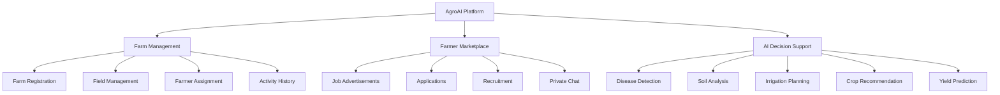

---

# ⚠️ 4. Problem Statement

Agricultural operations often involve multiple manual processes and coordination challenges.

### Identified Problems

| Problem | Description |
|---|---|
| Manual Farm Management | Managing multiple farms and fields manually can be difficult. |
| Worker Recruitment | Farm owners may struggle to find suitable agricultural workers. |
| Assignment Management | Tracking which farmer works on which field can become complicated. |
| Disease Identification | Early crop disease identification may be difficult without proper analysis. |
| Soil Monitoring | Agricultural soil information may not be systematically recorded. |
| Irrigation Decisions | Irrigation decisions may lack sufficient data-driven support. |
| Historical Records | Worker activities, payments, and field history may be difficult to maintain. |

### বাংলা ব্যাখ্যা

বর্তমানে অনেক কৃষি কার্যক্রম ম্যানুয়ালি পরিচালিত হয়। একাধিক জমি, শ্রমিক, নিয়োগ, মাটির তথ্য এবং ফসলের রোগের তথ্য একসঙ্গে পরিচালনা করা কঠিন হতে পারে।

AgroAI এই সমস্যাগুলোকে একটি কেন্দ্রীয় ডিজিটাল প্ল্যাটফর্মের মাধ্যমে সমাধানের লক্ষ্য নিয়ে তৈরি করা হচ্ছে।

---

# 💡 5. Proposed Solution

AgroAI proposes a unified system containing:

| Solution | Description |
|---|---|
| Digital Farm Management | Centralized farm and field management. |
| Farmer Marketplace | Job advertisement and application management. |
| Flexible Assignment | Multiple farmers can work on multiple fields. |
| AI Disease Detection | Crop image analysis using computer vision. |
| Soil Analysis | Machine-learning-based soil data analysis. |
| Irrigation Planner | Data-driven irrigation recommendations. |
| Historical Tracking | Store field, farmer, payment, and AI histories. |
| Private Communication | Context-based conversations between relevant users. |

---

# 🎯 6. Project Objectives

1. Develop a dynamic agricultural management platform.
2. Implement user registration and authentication.
3. Allow users to own and manage multiple farms.
4. Support multiple fields under a single farm.
5. Build a digital farmer recruitment marketplace.
6. Implement flexible farmer-to-field assignment.
7. Develop a farmer-specific workspace.
8. Integrate AI-based disease detection.
9. Implement soil analysis and irrigation planning.
10. Maintain payment, review, and activity records.
11. Apply Java Object-Oriented Programming principles.
12. Build a modular and maintainable software architecture.

---

# 👥 7. Target Users and User Roles

AgroAI supports three main user experiences.

## 7.1 General User

A general user can:

- Register an account.
- Log in.
- Explore publicly listed farms.
- Browse farmer job advertisements.
- Apply for available jobs.
- Register their own farm.
- Become a farm owner.
- Apply for agricultural work.

A user is not restricted to a single activity. The same account may own multiple farms and also apply for work.

## 7.2 Farm Owner

A farm owner can:

- Register a farm.
- Manage multiple farms.
- Create multiple fields.
- Access independent farm dashboards.
- Publish farmer job advertisements.
- Review job applications.
- Communicate with applicants.
- Approve suitable applicants.
- Assign farmers to selected fields.
- Monitor field-level AI analysis.
- Record payments and ratings.
- View activity history.

## 7.3 Farmer

An approved and assigned farmer can:

- Access their farmer workspace.
- View only their assigned fields.
- View permitted field information.
- Upload crop images.
- Submit soil telemetry.
- Request AI analysis.
- View AI results associated with their authorized fields.
- Participate in authorized conversations.

Farmers cannot access the full farm owner's dashboard unless separately authorized.

### User Relationship Diagram

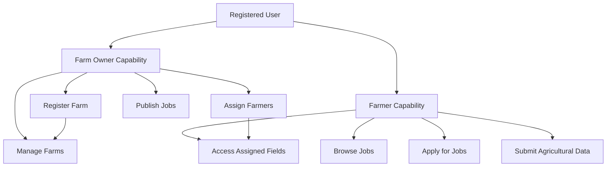

---

# 🧩 8. System Features and Modules

## 8.1 Public Landing Page

The landing page is the first page visitors see.

Features:

- Platform introduction.
- General user registration.
- Farm registration.
- Login.
- Explore farms.
- Explore farmer jobs.
- Information about AI capabilities.

## 8.2 User Authentication

- User registration.
- Login and logout.
- Firebase Authentication integration.
- Authenticated API access.
- Role and resource-based authorization.

## 8.3 Farm Management

Every authenticated user can register a farm.

Farm information includes:

- Farm name.
- Description.
- Location.
- Farm image.
- Farm size.
- Agricultural category.
- Public visibility preference.
- Owner information.

After successful registration, the creator becomes the owner of that farm.

A user may own multiple farms.

## 8.4 Field Management

Each farm may contain multiple fields.

Field information includes:

- Field name.
- Field location.
- Field area.
- Soil type.
- Crop information.
- Current agricultural status.
- Assigned farmers.
- Field history.

Every field has its own dashboard.

## 8.5 Farmer Marketplace

Farm owners can publish recruitment advertisements.

Job information includes:

- Job title.
- Farm information.
- Job description.
- Required experience.
- Work location.
- Payment information.
- Vacancy count.
- Job status.

General users can explore and apply for available jobs.

## 8.6 Application Management

Application lifecycle:

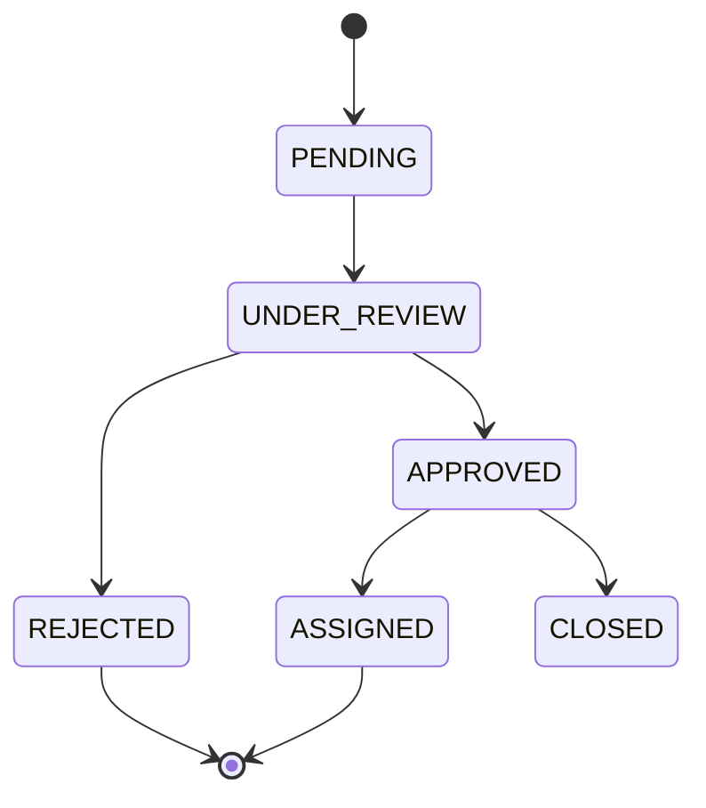

An approved applicant is not automatically assigned to every field.

The farm owner selects the appropriate field or fields.

## 8.7 Field Dashboard

Each field dashboard contains:

1. AI Analysis
2. Disease Detection
3. Irrigation Planner
4. History & Logs
5. Soil Telemetry
6. Assigned Farmers

## 8.8 Farmer Workspace

Farmers see only fields assigned to them.

Features:

- Assigned field list.
- Field-specific details.
- Crop image upload.
- Soil telemetry submission.
- AI result history.
- Relevant communication.

## 8.9 Live Chat

The platform supports private conversations related to:

- Job applications.
- Farm-related communication.
- Existing work assignments.

Chat access must be checked on the backend.

## 8.10 Payment and Rating Management

Farm owners can maintain records of:

- Farmer payments.
- Payment amounts.
- Payment status.
- Payment reference.
- Assignment completion.
- Farmer ratings.
- Work feedback.

A manually recorded payment is not proof that money was actually transferred.

## 8.11 History and Activity Logs

The system maintains records of:

- Farm creation.
- Field creation.
- Farmer assignments.
- Assignment releases.
- Job applications.
- AI submissions.
- AI results.
- Payments.
- Reviews.

---

# 🏗️ 9. System Architecture

AgroAI uses a modular architecture with a Java Spring Boot application as the main backend and a separate Python AI service.

### High-Level Architecture

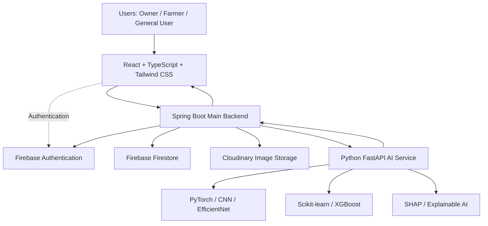

### Architecture Explanation

| Layer | Responsibility |
|---|---|
| Presentation Layer | User interface and dashboards. |
| Application Layer | REST API and business logic. |
| Security Layer | Authentication verification and authorization. |
| Persistence Layer | Firestore data management. |
| Media Layer | Cloudinary image storage. |
| AI Layer | Python-based AI processing. |

### Important Design Principle

Spring Boot remains the primary backend responsible for business operations, permissions, and application workflows.

Python FastAPI is a dedicated AI service.

The frontend should not directly access privileged Firestore or Cloudinary credentials.

---

# 💻 10. Technology Stack

## Frontend

| Technology | Purpose |
|---|---|
| React | UI development |
| TypeScript | Type safety |
| Tailwind CSS | Styling |
| React Router | Navigation |
| Fetch API / Axios | API communication |

## Backend

| Technology | Purpose |
|---|---|
| Java 21 | Main programming language |
| Spring Boot 3.x | Backend framework |
| Spring Web | REST APIs |
| Spring Security | Security |
| Firebase Admin SDK | Firebase integration |
| Springdoc OpenAPI | API documentation |
| WebSocket | Real-time chat |

## Database and Storage

| Technology | Purpose |
|---|---|
| Firebase Firestore | Application database |
| Firebase Authentication | User authentication |
| Cloudinary | Image storage |

## AI and Machine Learning

| Technology | Purpose |
|---|---|
| Python | AI programming |
| FastAPI | AI service API |
| PyTorch | Deep learning |
| CNN | Image classification |
| EfficientNet | Image classification architecture |
| Scikit-learn | Machine learning |
| XGBoost | Predictive modeling |
| OpenCV | Image processing |
| Pillow | Image handling |
| NumPy | Numerical processing |
| Pandas | Data analysis |
| SHAP | Explainable AI |

## Testing and Development

| Technology | Purpose |
|---|---|
| JUnit 5 | Java unit testing |
| Mockito | Mock testing |
| Pytest | Python testing |
| Postman | API testing |
| Git | Version control |
| GitHub | Collaboration |

---

# 📋 11. Software Requirements Specification (SRS)

## 11.1 Introduction

### Purpose

This SRS document defines the functional and non-functional requirements of AgroAI.

It describes system behavior, user roles, major modules, architectural requirements, and technical constraints.

### Scope

AgroAI is designed to provide:

- Digital agricultural management.
- Farmer recruitment.
- Field assignment.
- Agricultural data collection.
- AI-based decision support.
- Payment and rating records.
- Historical activity tracking.

### Intended Audience

- Project supervisor.
- University evaluators.
- Developers.
- Testers.
- Project stakeholders.

## 11.2 Product Perspective

AgroAI is a web-based software platform with multiple integrated services.

It consists of:

1. Web frontend.
2. Java Spring Boot backend.
3. Firebase services.
4. Cloud-based image storage.
5. Python AI microservice.

## 11.3 Product Functions

The system provides:

- User registration and login.
- Farm registration.
- Farm and field management.
- Job advertisement.
- Job applications.
- Farmer assignment.
- Field monitoring.
- Crop image submission.
- Disease detection.
- Soil analysis.
- Irrigation planning.
- Chat.
- Payment records.
- Ratings and reviews.
- Activity history.

## 11.4 Operating Environment

| Component | Environment |
|---|---|
| Frontend | Modern web browsers |
| Backend | Java 21 runtime |
| AI Service | Python runtime |
| Database | Firebase Cloud Firestore |
| Image Storage | Cloudinary |
| Development OS | Windows / Linux / macOS |
| Network | Internet connection |

## 11.5 User Characteristics

| User | Expected Capability |
|---|---|
| General User | Basic web application knowledge |
| Farm Owner | Farm and worker management |
| Farmer | Basic digital interaction and data submission |
| Administrator | Platform-level maintenance, if implemented |

## 11.6 Assumptions and Dependencies

- Users have internet access.
- Firebase services are available.
- Cloudinary account and storage limits permit uploads.
- AI models are available for inference.
- Farm owners provide accurate farm and field information.
- Agricultural recommendations depend on the quality of input data.
- Third-party services may have usage limits.

---

# ⚙️ 12. Functional Requirements

Functional requirements describe what the system must do.

| ID | Requirement | Priority |
|---|---|---|
| FR-01 | Users can register accounts. | High |
| FR-02 | Users can authenticate and log in. | High |
| FR-03 | Authenticated users can register farms. | High |
| FR-04 | A user can own multiple farms. | High |
| FR-05 | Farm owners can create multiple fields. | High |
| FR-06 | Farm owners can edit and manage their farms. | High |
| FR-07 | Public users can browse public farms. | Medium |
| FR-08 | Farm owners can publish job advertisements. | High |
| FR-09 | Users can apply for farmer jobs. | High |
| FR-10 | Farm owners can review applications. | High |
| FR-11 | Owners can approve or reject applications. | High |
| FR-12 | Owners can assign farmers to fields. | High |
| FR-13 | Multiple farmers can work on one field. | High |
| FR-14 | One farmer can work on multiple fields. | High |
| FR-15 | Farmers can access only authorized fields. | High |
| FR-16 | Farmers can upload crop images. | High |
| FR-17 | Farmers can submit soil telemetry. | High |
| FR-18 | The system can request AI analysis. | High |
| FR-19 | AI results are linked to submissions and fields. | High |
| FR-20 | The system maintains AI processing statuses. | High |
| FR-21 | Owners can release or reassign farmers. | High |
| FR-22 | Owners can record payments. | Medium |
| FR-23 | Owners can provide farmer ratings. | Medium |
| FR-24 | Authorized users can communicate privately. | Medium |
| FR-25 | The system maintains activity history. | High |
| FR-26 | Owners can configure farm visibility. | Medium |

---

# 🛡️ 13. Non-Functional Requirements

| ID | Requirement | Description |
|---|---|---|
| NFR-01 | Security | Protect private farm and user information. |
| NFR-02 | Performance | Avoid unnecessary API requests and expensive database reads. |
| NFR-03 | Scalability | Support additional farms, fields, users, and AI modules. |
| NFR-04 | Reliability | Handle failed API requests and AI processing errors. |
| NFR-05 | Maintainability | Use modular and reusable code. |
| NFR-06 | Usability | Provide clear and accessible interfaces. |
| NFR-07 | Compatibility | Support modern browsers. |
| NFR-08 | Data Integrity | Maintain consistent assignments and historical records. |
| NFR-09 | Privacy | Restrict access to private conversations and field information. |
| NFR-10 | Availability | Handle temporary third-party service failures gracefully. |
| NFR-11 | Testability | Implement unit, integration, and API tests. |
| NFR-12 | Observability | Record errors and relevant application events. |

---

# 📌 14. Use Case Diagram

```mermaid
flowchart TB
    G["General User"]
    O["Farm Owner"]
    F["Farmer"]

    subgraph AgroAI["AgroAI Platform"]
        UC1(("Register / Login"))
        UC2(("Explore Public Farms"))
        UC3(("Browse Jobs"))
        UC4(("Apply for Job"))

        UC5(("Register Farm"))
        UC6(("Manage Farm"))
        UC7(("Manage Fields"))
        UC8(("Publish Job"))
        UC9(("Review Applications"))
        UC10(("Assign Farmers"))
        UC11(("Manage Payments"))
        UC12(("View Farm History"))

        UC13(("View Assigned Fields"))
        UC14(("Upload Crop Image"))
        UC15(("Submit Soil Data"))
        UC16(("Request AI Analysis"))
        UC17(("View AI Results"))

        UC18(("Private Chat"))
    end

    G --> UC1
    G --> UC2
    G --> UC3
    G --> UC4

    O --> UC1
    O --> UC5
    O --> UC6
    O --> UC7
    O --> UC8
    O --> UC9
    O --> UC10
    O --> UC11
    O --> UC12
    O --> UC18

    F --> UC1
    F --> UC13
    F --> UC14
    F --> UC15
    F --> UC16
    F --> UC17
    F --> UC18
```

### Use Case Description: Register Farm

| Attribute | Description |
|---|---|
| Use Case ID | UC-01 |
| Actor | Authenticated User |
| Preconditions | User must be authenticated. |
| Main Flow | User opens farm registration, enters details, submits the form, and receives confirmation. |
| Postcondition | Farm is created and the user becomes its owner. |
| Alternative Flow | Invalid data or database failure returns an appropriate error. |

### Use Case Description: Apply for a Job

| Attribute | Description |
|---|---|
| Use Case ID | UC-02 |
| Actor | General User |
| Preconditions | User is authenticated and the job is open. |
| Main Flow | User views job details and submits an application. |
| Postcondition | Application is stored with PENDING status. |
| Alternative Flow | Duplicate or closed-job applications are rejected. |

### Use Case Description: Upload Crop Image

| Attribute | Description |
|---|---|
| Use Case ID | UC-03 |
| Actor | Assigned Farmer |
| Preconditions | Farmer has an active assignment to the relevant field. |
| Main Flow | Farmer selects a field, uploads an image, and requests disease detection. |
| Postcondition | Submission is stored and AI processing begins. |
| Alternative Flow | Invalid image or unauthorized field access is rejected. |

---

# 🧱 15. UML Class Diagram

The following conceptual UML model represents the core domain relationships. Actual Java classes may be divided into entities, DTOs, services, repositories, and security components.

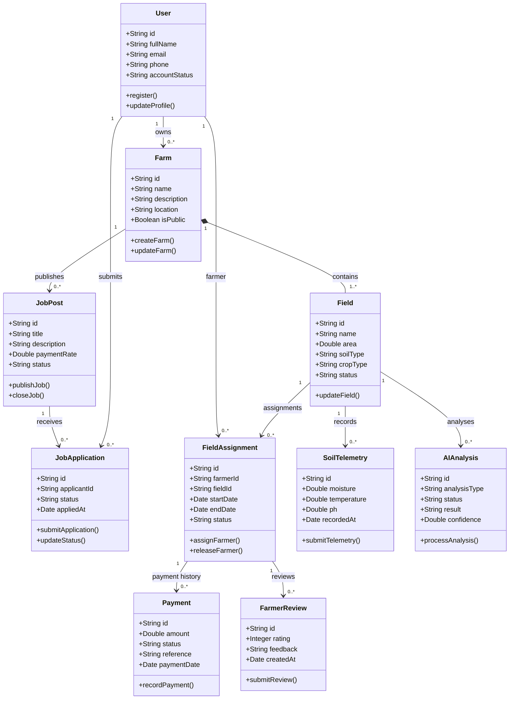

---

# 🗂️ 16. Entity Relationship and Firestore Data Design

AgroAI uses Firebase Firestore, which is a NoSQL document database.

The following diagram shows logical relationships, not SQL foreign-key constraints.

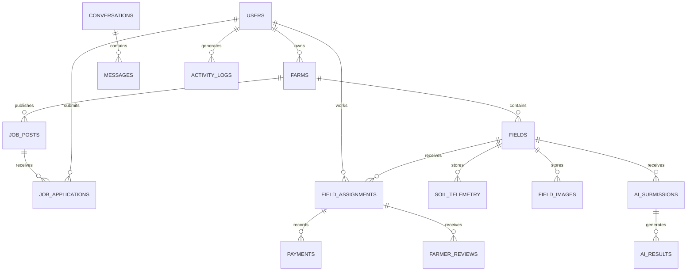

### Firestore Design Principles

- Use document IDs for unique record identification.
- Store references to related documents.
- Use subcollections where hierarchical data makes sense.
- Avoid excessively large documents.
- Design queries around real application access patterns.
- Use Firestore indexes for compound queries.
- Maintain historical records instead of deleting important operational history.
- Use server-side validation and authorization.

---

# 🗄️ 17. Database Collection Structure

| Collection | Main Fields |
|---|---|
| users | uid, fullName, email, phone, status |
| farms | farmId, ownerId, name, location, isPublic |
| fields | fieldId, farmId, name, area, soilType, cropType |
| fieldAssignments | assignmentId, farmerId, fieldId, status, startDate, endDate |
| jobPosts | jobId, farmId, title, description, paymentRate, status |
| jobApplications | applicationId, jobId, applicantId, status |
| conversations | conversationId, contextType, contextId, participantIds |
| messages | messageId, conversationId, senderId, message, createdAt |
| soilTelemetry | telemetryId, fieldId, moisture, temperature, ph |
| fieldImages | imageId, fieldId, farmerId, imageUrl, uploadedAt |
| aiSubmissions | submissionId, fieldId, submittedBy, type, status |
| aiResults | resultId, submissionId, fieldId, prediction, confidence |
| irrigationPlans | planId, fieldId, recommendation, createdAt |
| payments | paymentId, assignmentId, amount, status, reference |
| farmerReviews | reviewId, assignmentId, farmerId, rating, feedback |
| activityLogs | logId, actorId, action, resourceId, createdAt |

### Example: Farm Document

```json
{
  "farmId": "farm_001",
  "ownerId": "user_001",
  "name": "Green Valley Farm",
  "description": "A modern agricultural farm",
  "location": {
    "latitude": 24.0,
    "longitude": 90.0,
    "address": "Example Location"
  },
  "isPublic": true,
  "createdAt": "SERVER_TIMESTAMP",
  "updatedAt": "SERVER_TIMESTAMP"
}
```

### Example: Field Assignment Document

```json
{
  "assignmentId": "assignment_001",
  "farmerId": "user_002",
  "fieldId": "field_001",
  "farmId": "farm_001",
  "status": "ACTIVE",
  "startDate": "SERVER_TIMESTAMP",
  "endDate": null,
  "createdBy": "user_001"
}
```

### Example: AI Submission Document

```json
{
  "submissionId": "submission_001",
  "fieldId": "field_001",
  "farmId": "farm_001",
  "submittedBy": "user_002",
  "submissionType": "DISEASE_DETECTION",
  "imageUrl": "CLOUDINARY_IMAGE_URL",
  "status": "PENDING",
  "createdAt": "SERVER_TIMESTAMP"
}
```

---

# 🤖 18. AI Architecture and Workflow

AgroAI uses Python-based machine-learning services separately from the main Java backend.

## 18.1 AI Features

| Feature | Technology | Purpose |
|---|---|---|
| Disease Detection | PyTorch + CNN | Identify possible crop diseases from images. |
| Image Processing | OpenCV + Pillow | Prepare images for inference. |
| Soil Analysis | Scikit-learn | Analyze soil measurements. |
| Irrigation Planning | XGBoost / Scikit-learn | Generate irrigation recommendations. |
| Crop Recommendation | Random Forest / XGBoost | Recommend suitable crops. |
| Yield Prediction | XGBoost | Estimate potential production. |
| Explainable AI | SHAP | Explain influential prediction factors. |

## 18.2 AI Processing Workflow

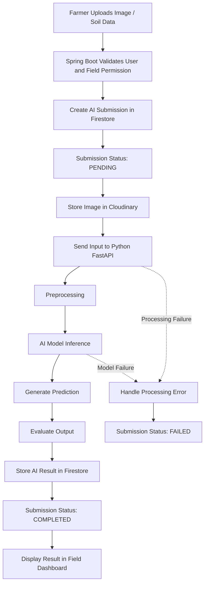

## 18.3 AI Submission Status

| Status | Meaning |
|---|---|
| PENDING | Submission has been created. |
| PROCESSING | AI analysis is running. |
| COMPLETED | Analysis has completed successfully. |
| FAILED | Analysis could not be completed. |

## 18.4 Disease Detection

Input:

- Crop image.
- Field identifier.
- Submission metadata.

Processing:

1. Validate field authorization.
2. Upload image to Cloudinary.
3. Preprocess image.
4. Run the trained model.
5. Generate prediction.
6. Store result and confidence information.
7. Display result in the relevant field dashboard.

Output may include:

- Predicted disease class.
- Confidence score.
- Model version.
- Analysis timestamp.
- Guidance based on validated agricultural information.

## 18.5 Soil Analysis

Potential input measurements:

- Soil moisture.
- Soil temperature.
- Soil pH.
- Nitrogen.
- Phosphorus.
- Potassium.

The actual model features must match the dataset used for training.

## 18.6 Irrigation Planning

Potential input:

- Soil moisture.
- Crop type.
- Growth stage.
- Available weather information.
- Soil characteristics.

Output:

- Irrigation recommendation.
- Suggested timing.
- Supporting factors.
- Data limitations.

## 18.7 AI Model Reliability

The project must distinguish between:

- Demonstration model.
- Trained model.
- Validated model.
- Production-ready model.

Do not represent random, hardcoded, or unvalidated outputs as reliable AI predictions.

---

# 🔄 19. Farmer Recruitment Workflow

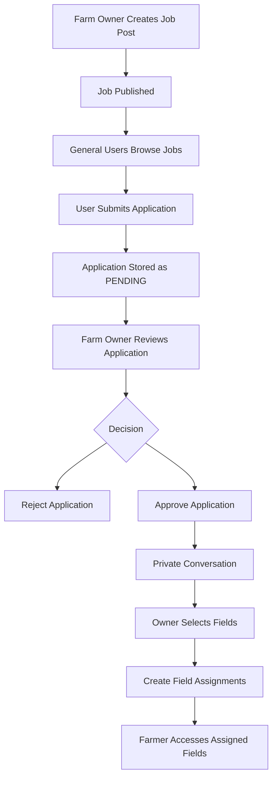

### Important Rule

Approving a job application does not automatically grant access to all farm fields.

Only explicit field assignments grant the corresponding farmer workspace access.

---

# 🔗 20. Farmer Assignment Workflow

AgroAI supports a many-to-many relationship between farmers and fields through assignment records.

### Relationship

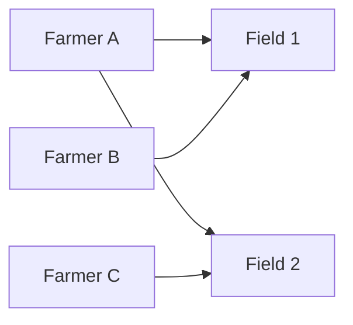

### Assignment Rules

1. Multiple farmers can work on one field.
2. One farmer can work on multiple fields.
3. Only authorized farm owners can assign farmers to their fields.
4. Approved applicants must be selected before assignment if recruitment is the source of employment.
5. Assignments must be stored as independent records.
6. Releasing a farmer must preserve assignment history.
7. Payment and review records must remain associated with the relevant assignment.

### Assignment Lifecycle

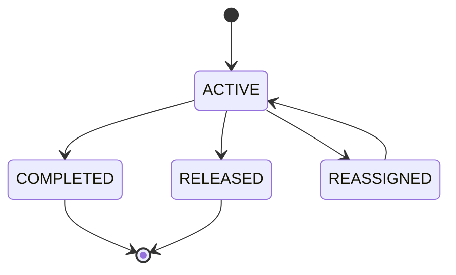

---

# 📊 21. Activity and Data Flow Diagrams

## 21.1 Level 0 — Context Diagram

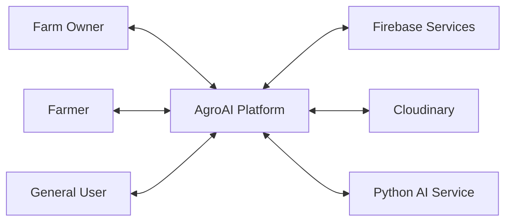

## 21.2 Level 1 — Main Data Flow

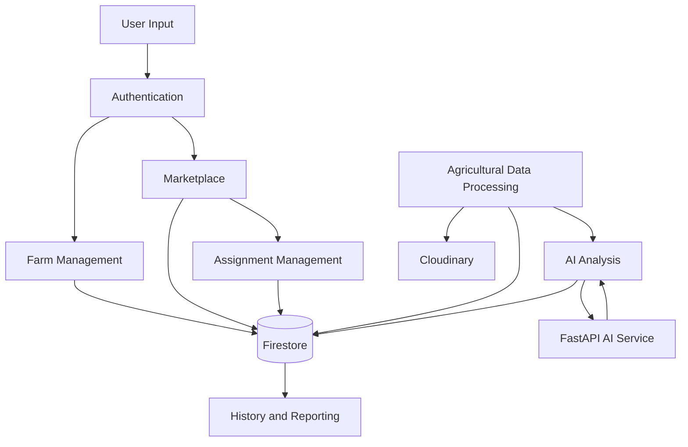

## 21.3 Image Upload Sequence Diagram

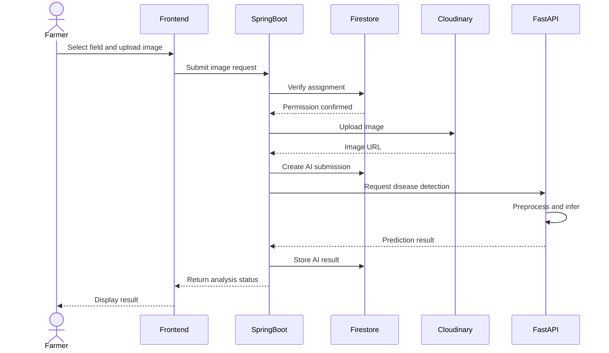

---

# 🔌 22. API Documentation Blueprint

The following endpoints represent the proposed REST API structure. They are design specifications, not claims of implemented endpoints.

## 22.1 Authentication

| Method | Endpoint | Description |
|---|---|---|
| POST | `/api/auth/register` | Register user |
| POST | `/api/auth/login` | Login or exchange authentication credentials |
| GET | `/api/auth/me` | Get current user |

## 22.2 Farm Management

| Method | Endpoint | Description |
|---|---|---|
| POST | `/api/farms` | Register farm |
| GET | `/api/farms` | List accessible farms |
| GET | `/api/farms/public` | Browse public farms |
| GET | `/api/farms/{farmId}` | Get farm details |
| PUT | `/api/farms/{farmId}` | Update farm |
| DELETE | `/api/farms/{farmId}` | Archive or delete farm according to retention policy |
| GET | `/api/farms/{farmId}/dashboard` | Farm dashboard data |

## 22.3 Field Management

| Method | Endpoint | Description |
|---|---|---|
| POST | `/api/farms/{farmId}/fields` | Create field |
| GET | `/api/farms/{farmId}/fields` | List fields |
| GET | `/api/fields/{fieldId}` | Get field |
| PUT | `/api/fields/{fieldId}` | Update field |
| GET | `/api/fields/{fieldId}/dashboard` | Get field dashboard |

## 22.4 Marketplace

| Method | Endpoint | Description |
|---|---|---|
| POST | `/api/jobs` | Publish job |
| GET | `/api/jobs` | Browse jobs |
| GET | `/api/jobs/{jobId}` | Get job details |
| PUT | `/api/jobs/{jobId}` | Update job |
| POST | `/api/jobs/{jobId}/applications` | Apply for job |
| GET | `/api/jobs/{jobId}/applications` | List applications |
| PATCH | `/api/applications/{applicationId}/status` | Review application |

## 22.5 Assignments

| Method | Endpoint | Description |
|---|---|---|
| POST | `/api/fields/{fieldId}/assignments` | Assign farmer |
| GET | `/api/fields/{fieldId}/assignments` | List field assignments |
| GET | `/api/farmers/me/assignments` | Farmer's assignments |
| PATCH | `/api/assignments/{assignmentId}/release` | Release farmer |
| GET | `/api/assignments/{assignmentId}` | Assignment details |

## 22.6 Agricultural Data and AI

| Method | Endpoint | Description |
|---|---|---|
| POST | `/api/fields/{fieldId}/telemetry` | Submit soil data |
| GET | `/api/fields/{fieldId}/telemetry` | Retrieve soil history |
| POST | `/api/fields/{fieldId}/disease-detection` | Submit disease detection request |
| POST | `/api/fields/{fieldId}/analysis` | Request AI analysis |
| GET | `/api/submissions/{submissionId}` | Get submission status |
| GET | `/api/fields/{fieldId}/analysis` | Get analysis history |
| GET | `/api/results/{resultId}` | Get AI result |

## 22.7 Chat, Payment and Rating

| Method | Endpoint | Description |
|---|---|---|
| POST | `/api/conversations` | Create authorized conversation |
| GET | `/api/conversations` | List accessible conversations |
| GET | `/api/conversations/{id}/messages` | Retrieve messages |
| POST | `/api/conversations/{id}/messages` | Send message |
| POST | `/api/assignments/{id}/payments` | Record payment |
| GET | `/api/assignments/{id}/payments` | Retrieve payment records |
| POST | `/api/assignments/{id}/reviews` | Submit review |

### WebSocket

Proposed WebSocket endpoint:

```text
/ws/chat
```

WebSocket connection and message delivery must enforce authentication and conversation membership.

---

# 🔐 23. Authentication and Authorization

AgroAI uses Firebase Authentication for user identity and Spring Security for backend authorization.

### Authentication Flow

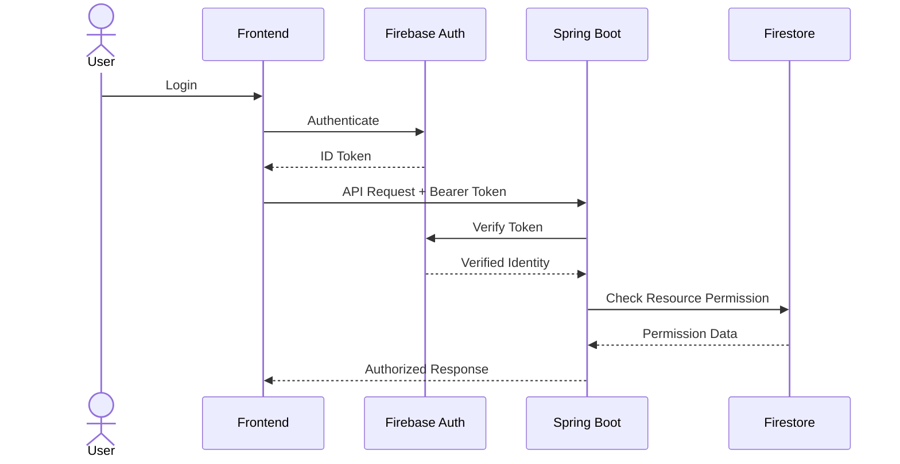

### Authorization Rules

| Resource | Permission |
|---|---|
| Public Farm | Any visitor, if public |
| Private Farm | Authorized owner and permitted members |
| Farm Dashboard | Farm owner and authorized members |
| Field Dashboard | Owner and authorized field members |
| Farmer Workspace | Farmer with active field assignment |
| Job Application | Applicant and relevant farm owner |
| Private Chat | Authorized conversation participants |
| Payment Records | Relevant authorized owner and farmer |
| AI Results | Authorized users of the relevant field |

### Security Principle

Hiding frontend buttons is not sufficient security.

Every sensitive operation must verify the authenticated user's permission on the backend.

---

# 🧠 24. Object-Oriented Programming Implementation

AgroAI is developed as an Object-Oriented Programming Lab project using Java.

The architecture should demonstrate core OOP concepts through real application components.

## 24.1 Encapsulation

Encapsulation protects object data and controls how it is modified.

Example:

```java
public class Field {

    private String fieldId;
    private String fieldName;
    private double area;

    public String getFieldName() {
        return fieldName;
    }

    public void updateFieldName(String fieldName) {
        if (fieldName == null || fieldName.isBlank()) {
            throw new IllegalArgumentException(
                "Field name cannot be empty"
            );
        }

        this.fieldName = fieldName;
    }
}
```

## 24.2 Inheritance

Inheritance allows specialized classes to reuse common behavior.

Example conceptual hierarchy:

```java
public abstract class AgriculturalRecord {

    protected String recordId;
    protected String fieldId;

    public abstract String getRecordType();
}
```

```java
public class SoilTelemetry extends AgriculturalRecord {

    private double moisture;

    @Override
    public String getRecordType() {
        return "SOIL_TELEMETRY";
    }
}
```

## 24.3 Polymorphism

Polymorphism allows different AI processors to implement a common interface.

```java
public interface AIAnalysisService {

    AnalysisResult analyze(AnalysisRequest request);
}
```

```java
public class DiseaseDetectionService
        implements AIAnalysisService {

    @Override
    public AnalysisResult analyze(
            AnalysisRequest request) {

        // Call disease detection service
        return new AnalysisResult();
    }
}
```

```java
public class SoilAnalysisService
        implements AIAnalysisService {

    @Override
    public AnalysisResult analyze(
            AnalysisRequest request) {

        // Call soil analysis service
        return new AnalysisResult();
    }
}
```

## 24.4 Abstraction

Interfaces and abstract classes define common behavior while hiding implementation details.

## 24.5 Composition

A farm contains fields, and each field contains or references its related agricultural records.

## 24.6 Association

Users, farms, fields, job applications, assignments, and payments have relationships.

### OOP Concept Mapping

| OOP Concept | AgroAI Example |
|---|---|
| Encapsulation | Field, Farm, User |
| Inheritance | AgriculturalRecord hierarchy |
| Polymorphism | AIAnalysisService implementations |
| Abstraction | Service interfaces |
| Composition | Farm and Field domain model |
| Association | User, Assignment and Field |
| Method Overriding | Specialized analysis implementations |

---

# 🖥️ 25. User Interface Structure

The platform is organized around different user experiences.

## Public Pages

```text
/
├── Landing Page
├── Login
├── Register
├── Explore Farms
├── Explore Jobs
└── Job Details
```

## Farm Owner Pages

```text
/owner
├── Dashboard
├── My Farms
├── Register Farm
├── Farm Details
├── Field Management
├── Farmer Management
├── Job Management
├── Applications
├── Chat
├── Payments
├── Ratings
└── Activity History
```

## Field Dashboard

```text
/fields/:fieldId
├── Overview
├── AI Analysis
├── Disease Detection
├── Irrigation Planner
├── Soil Telemetry
├── Assigned Farmers
└── History & Logs
```

## Farmer Workspace

```text
/farmer
├── Dashboard
├── Assigned Fields
├── Field Details
├── Upload Crop Image
├── Submit Soil Data
├── AI Results
├── Job Applications
└── Messages
```

These are proposed navigation routes. Final routing should follow the actual frontend implementation.

---

# 📁 26. Project Directory Structure

The following is the proposed monorepo structure.

```text
AgroAI/
│
├── README.md
├── LICENSE
├── .gitignore
├── .env.example
│
├── docs/
│   ├── SRS.md
│   ├── ARCHITECTURE.md
│   ├── UML.md
│   ├── DATABASE_DESIGN.md
│   ├── API_DOCUMENTATION.md
│   ├── AI_DOCUMENTATION.md
│   ├── SECURITY.md
│   └── TESTING.md
│
├── frontend/
│   ├── public/
│   ├── src/
│   │   ├── assets/
│   │   ├── components/
│   │   ├── pages/
│   │   ├── layouts/
│   │   ├── hooks/
│   │   ├── services/
│   │   ├── contexts/
│   │   ├── routes/
│   │   ├── types/
│   │   └── App.tsx
│   ├── package.json
│   └── README.md
│
├── backend/
│   ├── src/
│   │   ├── main/
│   │   │   ├── java/
│   │   │   │   └── com/agroai/
│   │   │   │       ├── config/
│   │   │   │       ├── security/
│   │   │   │       ├── auth/
│   │   │   │       ├── user/
│   │   │   │       ├── farm/
│   │   │   │       ├── field/
│   │   │   │       ├── marketplace/
│   │   │   │       ├── assignment/
│   │   │   │       ├── chat/
│   │   │   │       ├── telemetry/
│   │   │   │       ├── ai/
│   │   │   │       ├── payment/
│   │   │   │       ├── review/
│   │   │   │       ├── history/
│   │   │   │       └── common/
│   │   │   └── resources/
│   │   │       └── application.yml
│   │   └── test/
│   ├── pom.xml
│   └── README.md
│
├── ai-service/
│   ├── app/
│   │   ├── api/
│   │   ├── models/
│   │   ├── schemas/
│   │   ├── services/
│   │   ├── preprocessing/
│   │   └── main.py
│   ├── models/
│   ├── datasets/
│   ├── tests/
│   ├── requirements.txt
│   └── README.md
│
└── assets/
    ├── diagrams/
    ├── screenshots/
    └── presentation/
```

---

# 🚀 27. Installation and Setup

## Prerequisites

Install the following tools:

- Java Development Kit (JDK) 21.
- Maven.
- Node.js and npm.
- Python 3.10 or compatible version required by selected AI dependencies.
- Git.
- Firebase project.
- Cloudinary account.

## Step 1: Clone Repository

```bash
git clone https://github.com/YOUR-USERNAME/AgroAI.git

cd AgroAI
```

Replace `YOUR-USERNAME` with the actual GitHub username.

## Step 2: Frontend Setup

```bash
cd frontend

npm install

npm run dev
```

## Step 3: Backend Setup

```bash
cd backend

mvn clean install

mvn spring-boot:run
```

## Step 4: AI Service Setup

```bash
cd ai-service

python -m venv venv
```

Activate virtual environment.

Windows:

```powershell
venv\Scripts\activate
```

Linux/macOS:

```bash
source venv/bin/activate
```

Install dependencies:

```bash
pip install -r requirements.txt
```

Run the AI service:

```bash
uvicorn app.main:app --reload --port 8000
```

## Step 5: Verify Services

| Service | Example Local Address |
|---|---|
| React Frontend | http://localhost:5173 |
| Spring Boot | http://localhost:8080 |
| FastAPI | http://localhost:8000 |
| FastAPI Swagger | http://localhost:8000/docs |
| Springdoc Swagger | http://localhost:8080/swagger-ui/index.html |

These are proposed development defaults; actual ports may differ according to configuration.

---

# 🔑 28. Environment Configuration

Create environment configuration files locally.

Do not commit actual secrets to GitHub.

## Frontend Environment

Example `.env.example`:

```env
VITE_API_BASE_URL=http://localhost:8080/api

VITE_FIREBASE_API_KEY=your_firebase_api_key
VITE_FIREBASE_AUTH_DOMAIN=your_project.firebaseapp.com
VITE_FIREBASE_PROJECT_ID=your_project_id
VITE_FIREBASE_APP_ID=your_firebase_app_id
```

Firebase web configuration values are client configuration, not substitutes for backend authorization. Configure appropriate Firebase security and domain restrictions.

## Backend Environment

Example configuration:

```yaml
server:
  port: 8080

spring:
  application:
    name: agroai-backend

firebase:
  project-id: ${FIREBASE_PROJECT_ID}

cloudinary:
  cloud-name: ${CLOUDINARY_CLOUD_NAME}
  api-key: ${CLOUDINARY_API_KEY}
  api-secret: ${CLOUDINARY_API_SECRET}

ai:
  service-url: ${AI_SERVICE_URL:http://localhost:8000}
```

Firebase Admin SDK credentials should be provided through a secure service-account mechanism, such as a protected local credential file or workload identity.

## AI Service Environment

```env
AI_SERVICE_HOST=0.0.0.0
AI_SERVICE_PORT=8000

MODEL_PATH=models/disease_model.pth

MODEL_VERSION=development
```

### Security Warning

Never upload:

- Firebase service account JSON files.
- Cloudinary API secrets.
- Private API keys.
- Authentication tokens.
- Production credentials.

Add all secret files to `.gitignore`.

---

# 🗺️ 29. Development Roadmap

The project will be developed through seven major milestones.

| Milestone | Main Deliverable |
|---|---|
| 1 | Requirement analysis, SRS, UML, architecture and Firestore design |
| 2 | Authentication, user accounts and farm registration |
| 3 | Farm dashboard, field management and access control |
| 4 | Farmer marketplace, job applications and chat |
| 5 | Assignments, payment records, ratings and history |
| 6 | AI integration, crop images, soil telemetry and analysis |
| 7 | Integration, testing, documentation and final presentation |

### Milestone Dependency

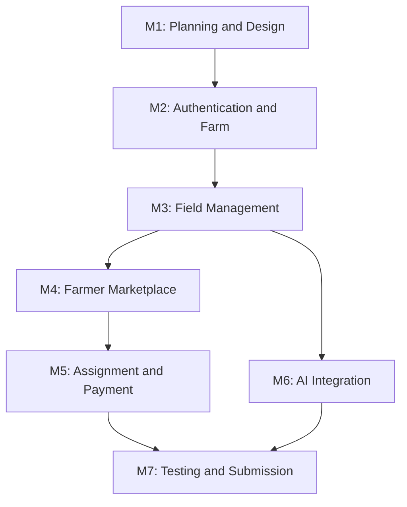

---

# 👨‍💻 30. Team Responsibilities

The project is developed by a team of three members.

## Member 1 — Backend and System Architecture

Responsibilities:

- Java 21.
- Spring Boot.
- Firebase integration.
- Authentication and authorization.
- Farm registration.
- Field management.
- Backend business logic.
- Core OOP architecture.
- API development.

## Member 2 — Frontend and Marketplace

Responsibilities:

- React.
- TypeScript.
- Tailwind CSS.
- Public landing page.
- Registration and login UI.
- Owner dashboard.
- Farmer workspace.
- Job marketplace.
- Application interfaces.
- Chat interface.
- Frontend API integration.

## Member 3 — AI and Agricultural Intelligence

Responsibilities:

- Python.
- FastAPI.
- PyTorch.
- Disease detection.
- Image preprocessing.
- Soil analysis.
- Irrigation recommendation.
- Crop recommendation.
- Yield prediction.
- AI API integration.
- Model evaluation.

### Shared Responsibilities

All members participate in:

- Requirement analysis.
- Database design.
- API contract decisions.
- Integration.
- Testing.
- Documentation.
- Final presentation.

### Team Member Information

| Role | Name | Student ID |
|---|---|---|
| Member 1 | To be added | To be added |
| Member 2 | To be added | To be added |
| Member 3 | To be added | To be added |

---

# 🧪 31. Testing Strategy

Testing will be conducted at multiple levels.

## Unit Testing

Backend:

- JUnit 5.
- Mockito.

AI service:

- Pytest.

Frontend:

- Component and interaction tests.

## Integration Testing

Test:

- Authentication integration.
- Firestore operations.
- Cloudinary uploads.
- Spring Boot to FastAPI communication.
- Job application workflow.
- Field assignment workflow.
- AI result persistence.

## Authorization Testing

Verify that:

- A user cannot manage another user's private farm.
- A farmer cannot access an unassigned field.
- An unauthorized user cannot approve an application.
- A user cannot read private conversations without membership.
- An unrelated user cannot access payment records.

## AI Testing

Evaluate:

- Model accuracy.
- Precision.
- Recall.
- F1-score.
- Confusion matrix.
- Inference failures.
- Input validation.

For image classification, test the model on data that was not used for training.

## Acceptance Testing

The system should demonstrate:

1. Successful user registration.
2. Farm registration.
3. Field creation.
4. Job publication.
5. Job application.
6. Application review.
7. Farmer assignment.
8. Restricted farmer workspace.
9. Crop image submission.
10. AI result storage and display.
11. Payment and rating history.

---

# 🔒 32. Security Considerations

Security is an essential part of AgroAI.

### Authentication

- Firebase Authentication.
- Firebase ID token verification on the backend.
- Secure session and token handling.

### Authorization

- Resource ownership validation.
- Field assignment validation.
- Conversation membership validation.
- Payment record access validation.

### Data Protection

- Keep credentials outside the repository.
- Validate all API inputs.
- Restrict image uploads by type and size.
- Use HTTPS in deployment.
- Avoid exposing sensitive database information.
- Use secure Cloudinary upload mechanisms.

### AI Service Security

- Do not expose the AI service publicly without protection.
- Validate all AI requests.
- Restrict access to the AI service.
- Validate image URLs and input sizes.
- Handle model errors safely.

### Data Integrity

- Preserve assignment history.
- Preserve relevant payment history.
- Store timestamps consistently.
- Avoid duplicate job applications.
- Validate state transitions.

---

# 🌍 33. Future Improvements

Possible future enhancements include:

- IoT-based soil moisture sensors.
- Real-time environmental monitoring.
- Weather API integration.
- Advanced crop disease detection.
- More agricultural datasets.
- Bengali-language AI recommendations.
- Mobile application.
- Advanced yield prediction.
- Automated agricultural alerts.
- Satellite-based crop monitoring.
- Farm performance analytics.
- Agricultural marketplace expansion.

---

# ⚠️ 34. Limitations

The initial project version may have the following limitations:

1. AI accuracy depends on dataset quality and model validation.
2. Crop disease predictions may not cover every crop or disease.
3. Irrigation recommendations depend on available input data.
4. Real-time soil telemetry requires external sensors or manual submissions.
5. Cloudinary and Firebase free plans have usage and storage limits.
6. Internet access is required for cloud-based services.
7. Payment records are not equivalent to verified financial transactions.
8. The system does not guarantee agricultural outcomes.

AgroAI is intended as an agricultural decision-support platform, not a replacement for qualified agricultural expertise.

---

# ❓ 35. Frequently Asked Questions

### Q1. What is AgroAI?

AgroAI is a digital agricultural management and AI-assisted decision support platform.

### Q2. Which backend technology is used?

Java 21 with Spring Boot 3.

### Q3. Which database is used?

Firebase Cloud Firestore.

### Q4. Why is Python used?

Python provides machine-learning and deep-learning libraries used by the AI service.

### Q5. Can a user own multiple farms?

Yes. One registered user can own multiple farms.

### Q6. Can multiple farmers work on the same field?

Yes. AgroAI supports multiple farmer assignments per field.

### Q7. Can one farmer work on multiple fields?

Yes. Assignment records support this relationship.

### Q8. Where are uploaded images stored?

Images are stored in Cloudinary. Their URLs and metadata are maintained in Firestore.

### Q9. Can farmers access all farm information?

No. Farmers receive access to their assigned fields and permitted operations only.

### Q10. Is the AI model production-ready?

Not necessarily. Model readiness depends on training, evaluation, and validation. Demonstration outputs must be clearly identified.

### Q11. Does AgroAI process actual financial transactions?

The initial design supports payment record management. Actual financial transactions would require a separate payment gateway integration.

---

# 👨‍👩‍👦 36. Contributors

Developed as a three-member university OOP Lab project.

| Member | Responsibility |
|---|---|
| Member 1 | Backend and System Architecture |
| Member 2 | Frontend and Marketplace |
| Member 3 | AI and Agricultural Intelligence |

**University:** [University Name]

**Department:** Computer Science and Engineering

**Course:** Object-Oriented Programming Lab

**Supervisor:** [Faculty Name]

---

# 🙏 37. Acknowledgements

We would like to express our gratitude to our course instructor and university for providing the opportunity to develop this project.

We also acknowledge the developers and communities behind Java, Spring Boot, React, Firebase, Python, PyTorch, Scikit-learn, and other open-source technologies that support modern software development.

---

<p align="center">

# 🌱 AgroAI

### Smart Agriculture. Connected Farmers. Intelligent Decisions.

**Building a smarter agricultural ecosystem through software engineering and artificial intelligence.**

</p>

<p align="center">
  Made with dedication by the AgroAI Team.
</p>
